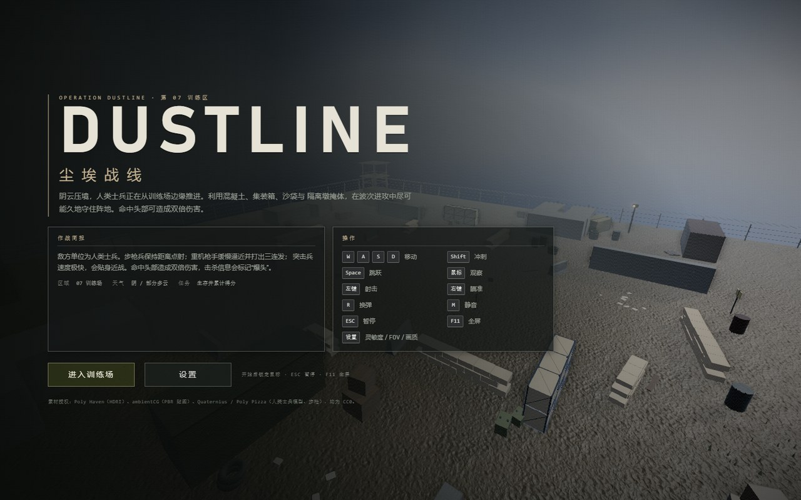
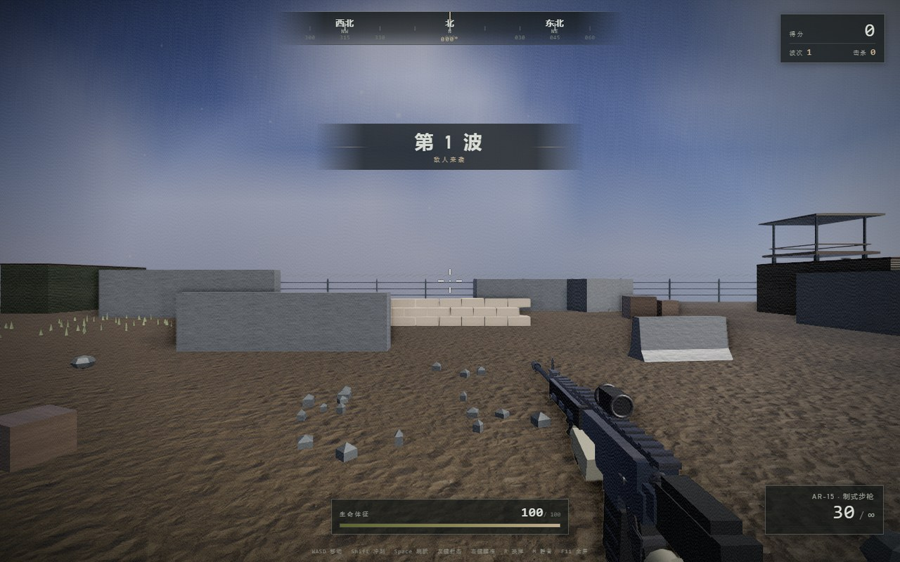
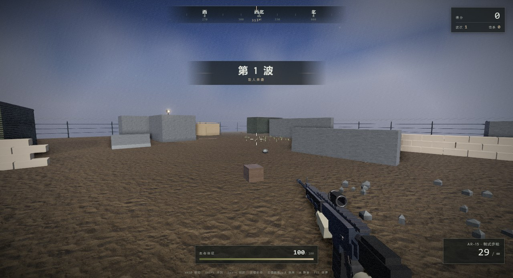
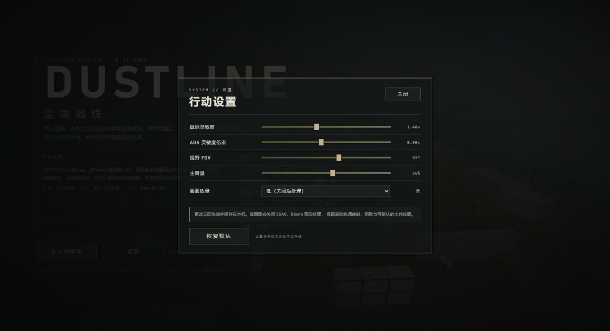
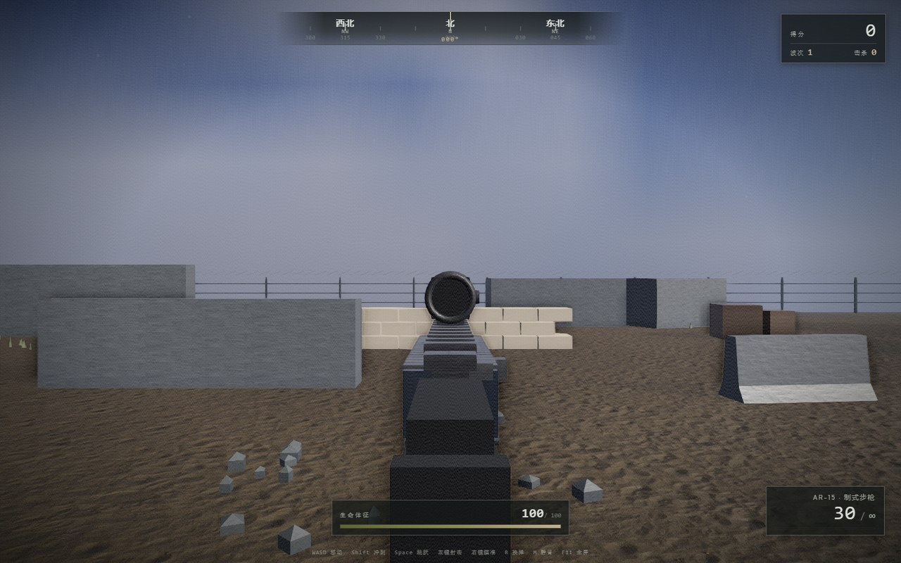
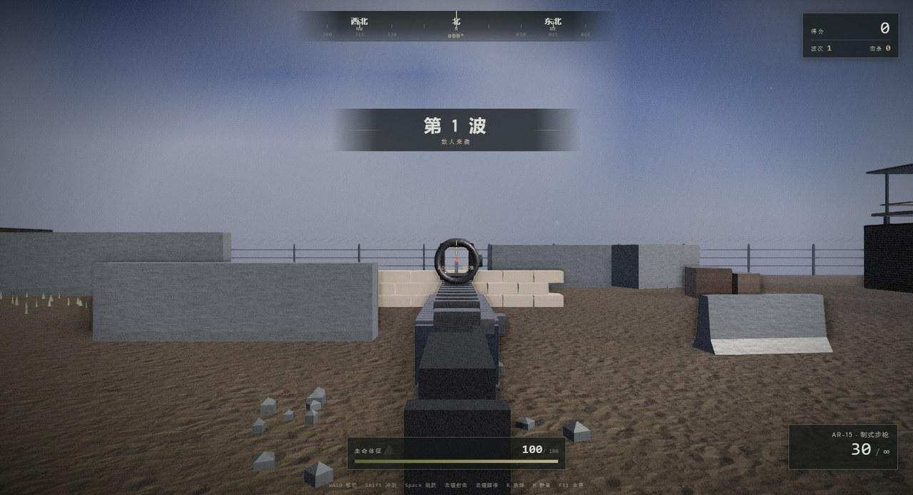
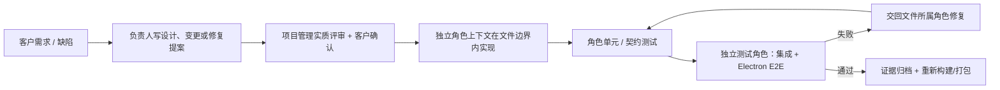
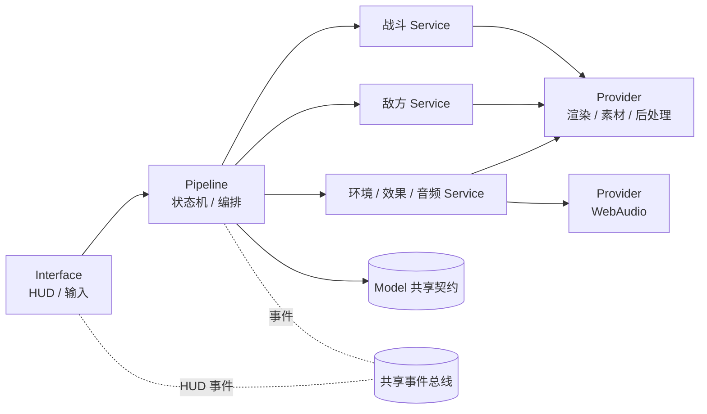

# DUSTLINE · 尘埃战线

[](https://github.com/wangzhongren/ans-skill)
[](https://www.electronjs.org/)
[](https://threejs.org/)
[](#运行)

**一个基于 [ANS Skill](https://github.com/wangzhongren/ans-skill)（`ans-governed-construction`）开发的 Windows 桌面 3D FPS。**

这个仓库的主角不只是游戏，而是 **ANS 的工程方法**：8 个角色、文件级写边界、设计先行、分层契约、独立测试、缺陷闭环和可追溯证据。游戏是载体，用来展示这套方法能否在真实、持续变化的交付中工作。

> **English:** DUSTLINE is a desktop FPS built with Electron + Three.js. More importantly, it is a real-world showcase of the **ANS (ans-governed-construction)** skill: an eight-role, boundary-controlled, design-first AI engineering workflow with independent verification and evidence-backed delivery.

| 主菜单 | 对局 |
| --- | --- |
|  |  |

| 人类士兵 | 设置 |
| --- | --- |
|  |  |

**ADS 黑镜缺陷修复前后**（右键开镜从黑圆变成可透视镜框）：

| 修复前 | 修复后 |
| --- | --- |
|  |  |

## 游戏是什么

DUSTLINE 是一款单人波次生存射击游戏，目标是在写实军事训练场中尽可能久地活下去：

- **人类士兵敌人**：步枪兵、重机枪手、突击兵；持枪、奔跑射击、受击、死亡动画；头盔、面罩、防弹衣、弹匣袋、护膝、手套；头部/身体独立命中盒，爆头 2 倍伤害。
- **第一人称武器**：AR-15 风格高细节步枪 + 戴手套双手；红点镜、ADS、后坐模式、镜头震动、换弹/抛壳动画、枪口闪光与烟雾。
- **射击反馈**：曳光、命中血雾/尘土、弹孔、爆头命中标记、击杀信息、分层枪声、脚步与风声。
- **场景与后处理**：HESCO、沙袋墙、隔离墩、集装箱、托盘、轮胎、帐篷、警戒塔、围栏、警示牌、探照灯、碎石/草丛/污渍；SSAO、Bloom、色彩分级、SMAA、暗角与颗粒；高/低画质可切换。
- **完整对局流程**：菜单 → 波次战斗 → 暂停 → 死亡结算 → 重开；灵敏度、ADS 倍率、FOV、音量与画质设置本地保存。
- **Windows 桌面程序**：Electron 窗口，非浏览器 Demo；可直接运行解包版或安装包。

## 运行

要求 Windows 10/11 x64、Node.js 20+。

```bash
npm install
npm start
```

`npm start` 会先构建渲染进程，再启动 Electron 窗口。其他命令：

```bash
npm run build   # 只构建
npm run dev     # 浏览器调试
npm run pack    # 生成 Windows 未压缩应用目录
npm run dist    # 生成 NSIS 安装包
```

操作：`WASD` 移动、`Shift` 冲刺、`Space` 跳跃、鼠标观察、左键射击、右键 ADS、`R` 换弹、`M` 静音、`F11` 全屏、`ESC` 暂停。

## 为什么这是一个 ANS 展示项目

ANS 的核心不是“让 AI 写更多代码”，而是回答三个问题：**谁对结果负责、允许改哪些文件、凭什么说改对了。** 这个仓库把三件事都留下了证据。

### 1. 八个角色，文件级写边界

| 角色 | 负责什么 | 主要写范围 |
| --- | --- | --- |
| 项目管理 | 架构、跨角色契约评审、调度、共享事件总线 | `src/common/shared/`、`docs/architecture.md`、调度记录 |
| 美术 | CC0 素材、授权、材质映射、视觉验收 | `resource/`、美术方向与资产文档 |
| 界面装配 | HUD/菜单/暂停/结算、输入、Electron 壳、构建打包 | `index.html`、`src/style.css`、`src/interface/`、`electron/`、构建配置 |
| 游戏管线 | 共享 Model、状态机、主循环、设置与事件编排 | `src/models/`、`src/pipelines/` |
| 战斗服务 | 移动、跳跃、武器、后坐力、ADS、弹药、生命 | `src/services/{abstract,public,impl}/combat*`、`view-model.js` |
| 敌方服务 | 人类士兵、波次、AI、弹丸、命中盒、掉落 | `src/services/{abstract,public,impl}/enemies*`、`human-visual.js` |
| 环境引擎 | 场景、道具、效果、音频、渲染/素材/后处理 Provider | `src/services/impl/{environment,effects,audio}/`、`src/providers/` |
| 独立测试 | 跨角色集成、Electron E2E、回归与测试报告 | `test/独立测试/` |

每个角色的 `boundary.md` 第 1 节是唯一写权限白名单；不在白名单中的文件默认只读。角色卡、边界与调度配置只能由 ANS Governance 在客户确认后更新。

### 2. 设计先行，变更可追溯

这不是一次“生成后不管”的交付。项目经历了完整的变更链：



- **设计 v1**：赛博霓虹竞技场原型；客户确认后、实施前改为写实军事方向。
- **设计 v2**：客户要求类似 PUBG 的写实军事美术；新增独立“美术”角色，引入 CC0 HDRI/PBR 纹理/模型；首个可玩交付使用军用机械敌人。
- **设计 v3**：客户要求“打人”、重做射击手感与美术；敌人改为 Quaternius CC0 动画人类士兵，重做 AR-15 视图模型、后坐/音效/后处理/设置，并完成三项美术打磨。
- **ADS 缺陷修复**：客户报告“开镜镜内是黑的”；定位为实心镜体遮挡，改为开放镜框 + 透光镜片 + 高亮红点，并新增 ADS 中心亮度/红点像素回归断言。

每一次实质变更都先写入设计/变更/修复文档，再分派到对应角色；最终由独立测试角色复核，而不是由实现者自己宣布完成。

### 3. 分层契约与单一拥有者



- `Interface → Pipeline → Service → Provider` 是唯一允许的调用方向。
- Service 之间不互相导入；战斗与敌人的协作由 Pipeline 注入只读快照/目标查询。
- `src/models/` 由游戏管线单一拥有；`src/common/shared/event-bus.js` 由项目管理拥有。
- Three.js 与 WebAudio 被封装在 Provider 公共入口之后；服务不接触 `impl/`。

### 4. 独立验证，而不是“实现者说完成”

- `npm run build`：通过。
- 约 210 项角色/界面单元与契约检查、12 项跨角色集成、5 项 Electron E2E：通过。
- ADS 专项：65 项战斗测试；开发构建与重新打包应用的 ADS 中心亮度约 130/255、红点像素检测通过。
- 解包应用与 NSIS 安装包均从最终源码重建，并用独立测试复核。

完整展示说明与证据索引见 **[docs/ANS_SHOWCASE.md](docs/ANS_SHOWCASE.md)**。

## 从哪里看 ANS 工件

| 内容 | 位置 |
| --- | --- |
| 设计总纲与 v3 修订、批准记录 | [docs/governance/2026-10-17_bootstrap-and-game-design.md](docs/governance/2026-10-17_bootstrap-and-game-design.md) |
| 总体架构 | [docs/architecture.md](docs/architecture.md) |
| 项目工程规则 | [docs/project-rules.md](docs/project-rules.md) |
| 调度与阶段证据 | [docs/scheduling/neon-strike-delivery.md](docs/scheduling/neon-strike-delivery.md) |
| 角色卡与文件边界 | [角色卡/](角色卡/) |
| 共享组件说明 | [docs/architecture/shared-components.md](docs/architecture/shared-components.md) |
| 独立测试报告 | [角色卡/独立测试/docs/reports/2026-10-17_report_initial-verification.md](角色卡/独立测试/docs/reports/2026-10-17_report_initial-verification.md) |
| ADS 黑镜修复记录 | [角色卡/战斗服务/docs/fix/2026-10-17_fix_ads-black-scope.md](角色卡/战斗服务/docs/fix/2026-10-17_fix_ads-black-scope.md) |
| ANS Skill | [github.com/wangzhongren/ans-skill](https://github.com/wangzhongren/ans-skill) |

## 目录结构

```text
src/
  interface/    HUD、菜单、输入、设置
  pipelines/    对局状态机、主循环、服务编排
  models/       共享配置、事件与跨角色契约
  services/     战斗、敌方、环境、效果、音频
  providers/    Three.js 渲染/素材/后处理、WebAudio
  common/       共享事件总线
electron/       Electron 主进程
resource/       CC0 HDRI、PBR 贴图、人类模型与授权清单
角色卡/         8 个角色的角色卡、边界、功能/设计/变更/修复文档
docs/           治理设计、架构、调度、项目规则与展示图
test/           按角色分组的单元/契约测试、集成/E2E 与报告
```

## 素材与授权

- 世界美化素材均为 **CC0**：Poly Haven HDRI、ambientCG PBR 贴图、Quaternius/Poly Pizza 人类模型与步枪模型。
- 具体来源、作者、授权和文件路径见 [resource/ATTRIBUTIONS.md](resource/ATTRIBUTIONS.md) 与 [resource/asset-manifest.json](resource/asset-manifest.json)。
- 游戏代码：当前为 `UNLICENSED`（未声明开源许可）。如需以 MIT / Apache-2.0 发布，请补充 `LICENSE` 并同步 `package.json`。

## 已知限制

- 免费且授权清晰的动画人物素材以低多边形为主；本项目的写实军事观感来自装备、PBR、动画、光照与后处理，**不是 PUBG 照片级**。
- 真人长时间手感、听音、30 敌人高画质性能、连续重开内存、安装包安装/卸载/签名/图标尚未验证；报告中没有把它们写成通过。
- 已批准调度配置中的 `writeFiles` 含角色文档路径，`task_ops` CLI 会将其视为治理文件而拒绝初始化；本项目按授权使用手工调度记录，详见调度文档。
- Vite 生产构建存在单 chunk >500KB 警告；未做代码分割。
