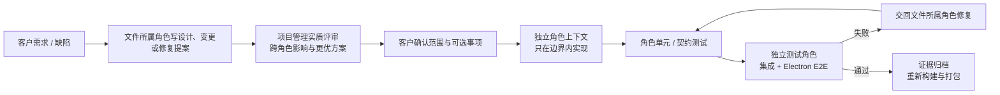

# ANS 工程能力展示：DUSTLINE 是怎么被做出来的

> 这个仓库基于 [ANS Skill](https://github.com/wangzhongren/ans-skill)（`ans-governed-construction`）开发。  
> 游戏只是交付物；真正想展示的是：**在需求持续变化、需要多轮修复的真实项目里，ANS 能否把 AI 开发组织成可检查、可交接、可验收的工程过程。**

## 1. 一句话概括

ANS 用“角色”管责任，用“文件边界”管写权限，用“设计/变更/修复文档”管决策，用“独立测试角色 + 证据”管验收。

在这个项目里：

- 8 个角色各自拥有明确的文件白名单；
- 治理上下文只维护角色卡、边界与批准记录，不写应用代码；
- 每次实质变更先有提案与客户确认，再进入独立角色上下文实现；
- 实现者写自己的单元/契约测试，独立测试角色做跨角色集成与 Electron E2E；
- 所有交付、返工和缺陷修复都留下日期化文档与可复现命令。

## 2. 八个角色

| 角色 | 职责 | 关键写范围 | 角色卡 / 边界 |
| --- | --- | --- | --- |
| 项目管理 | 架构、契约评审、调度、共享事件总线 | `src/common/shared/`、架构/规则/调度文档 | [角色卡](../角色卡/项目管理/role-card.md) / [边界](../角色卡/项目管理/boundary.md) |
| 美术 | CC0 素材、授权、材质映射、视觉验收 | `resource/`、美术方向与资产文档 | [角色卡](../角色卡/美术/role-card.md) / [边界](../角色卡/美术/boundary.md) |
| 界面装配 | HUD/菜单/暂停/结算、输入、Electron 壳、构建打包 | `index.html`、样式、Interface、Electron、构建配置 | [角色卡](../角色卡/界面装配/role-card.md) / [边界](../角色卡/界面装配/boundary.md) |
| 游戏管线 | 共享 Model、状态机、主循环、设置与事件编排 | `src/models/`、`src/pipelines/` | [角色卡](../角色卡/游戏管线/role-card.md) / [边界](../角色卡/游戏管线/boundary.md) |
| 战斗服务 | 移动、跳跃、武器、后坐力、ADS、弹药、生命 | 战斗 Service、武器视图模型 | [角色卡](../角色卡/战斗服务/role-card.md) / [边界](../角色卡/战斗服务/boundary.md) |
| 敌方服务 | 人类士兵、波次、AI、弹丸、命中盒、掉落 | 敌方 Service、人类视觉与动画 | [角色卡](../角色卡/敌方服务/role-card.md) / [边界](../角色卡/敌方服务/boundary.md) |
| 环境引擎 | 场景、道具、效果、音频、渲染/素材/后处理 Provider | 环境/效果/音频 Service、Provider | [角色卡](../角色卡/环境引擎/role-card.md) / [边界](../角色卡/环境引擎/boundary.md) |
| 独立测试 | 跨角色集成、Electron E2E、回归、测试报告 | `test/独立测试/` | [角色卡](../角色卡/独立测试/role-card.md) / [边界](../角色卡/独立测试/boundary.md) |

每个 `boundary.md` 的第 1 节都是唯一写白名单。没有“凭理解就能改”的隐含权限；跨角色需求回到项目管理协调。

## 3. 一次变更怎么流动



关键点：

1. **阅读范围可以很广，写范围必须很窄。** 角色可以读其他模块来定位问题，但修复由文件所有者完成。
2. **设计不是装饰。** v2 改变美术方向、v3 把敌人改为人类士兵，都先升级设计并重新确认；ADS 黑镜修复也有日期化修复记录。
3. **实现者不给自己发合格证。** 独立测试角色从真实 Electron 入口跑完整流程，不把“实现者说完成”当作验收。
4. **证据会失效。** 契约或依赖变化后，受影响测试必须重跑；旧结果不能继续当作当前版本的通过依据。

## 4. 交付与变更时间线

| 日期 | 阶段 | 发生了什么 | 证据 |
| --- | --- | --- | --- |
| 2026-10-17 | ANS 引导 | 建立角色卡、文件边界、设计 v1（霓虹原型）；客户确认授权 | [设计总纲](../docs/governance/2026-10-17_bootstrap-and-game-design.md)、[治理日志](../docs/governance/changelog.md) |
| 2026-10-17 | v2 设计修订 | 客户要求类似 PUBG 的写实军事美术；新增独立“美术”角色；改用 CC0 素材；在实施前重新确认 | 设计文档 v2 与批准记录 |
| 2026-10-17 | 首次可玩交付 | Electron 桌面版 DUSTLINE v1.0.0；机械敌人；构建/测试/打包通过 | [调度记录](../docs/scheduling/neon-strike-delivery.md)、[测试报告](../角色卡/独立测试/docs/reports/2026-10-17_report_initial-verification.md) |
| 2026-10-17 | v3 修订 | 客户要求“不要打无人机、要打人”，并重做射击手感与美术；确认全量升级 | 设计文档 v3 / §12 |
| 2026-10-17 | v3 交付 | 人类士兵（步枪兵/重机枪手/突击兵）、AR-15 视图模型、后坐/换弹/枪声、场景道具、后处理、设置面板；重新打包 | 测试报告 §10–11、v3 截图 |
| 2026-10-18 | ADS 缺陷修复 | 客户报告开镜黑屏；定位实心镜体遮挡；开放镜框 + 透光镜片 + 高亮红点；新增中心亮度/红点回归断言 | [修复记录](../角色卡/战斗服务/docs/fix/2026-10-17_fix_ads-black-scope.md)、[治理日志](../docs/governance/changelog.md) |

## 5. 证据与独立验证

### 构建与测试

- `npm run build`：通过（Vite 生产构建）。
- 约 210 项角色/界面单元与契约检查、12 项跨角色集成、5 项 Electron E2E：通过。
- ADS 专项：65 项战斗结构/逻辑测试；Electron 中 ADS 中心平均亮度约 130/255（修复前约 53），红点像素检测通过。
- 解包应用与 NSIS 安装包均从最终源码重建，并用独立测试复核。

### 实际运行验证

- 菜单 → 开始 → HUD → 移动/射击/换弹/ADS → 波次 → 暂停/继续 → 死亡结算 → 重开。
- 人类士兵实际生成，无无人机/机械敌人残留。
- 设置面板实际修改灵敏度/FOV/音量/画质，低画质关闭后处理，跨重启保留。
- 画面截图保存在 `test/项目管理/screenshots-v3/`、`test/独立测试/fixtures/screenshots-v3/` 与 `screenshots-v3-ads-fix/`（本地证据目录，不全部提交到 Git）。

### 可交叉检查的文档

- 设计、批准记录、v2/v3 修订：[设计总纲](../docs/governance/2026-10-17_bootstrap-and-game-design.md)
- 架构与共享组件：[架构](../docs/architecture.md)、[共享组件](../docs/architecture/shared-components.md)
- 项目管理要求：[项目规则](../docs/project-rules.md)
- 阶段计划、依赖与证据：[调度记录](../docs/scheduling/neon-strike-delivery.md)
- 每个角色的实际导出与偏差：`角色卡/<角色>/api-spec.md`
- 每个功能的当前行为与流程图：`角色卡/<角色>/docs/feature/`
- 缺陷修复：[ADS 黑镜修复记录](../角色卡/战斗服务/docs/fix/2026-10-17_fix_ads-black-scope.md)

## 6. 这个项目展示了什么

| 能力 | 在项目里的具体表现 |
| --- | --- |
| 责任与权限分离 | 8 个角色 + 文件级白名单；治理解释“为什么”，角色负责“改什么” |
| 设计先行 | 美术方向、人类敌人、ADS 缺陷都先有文档与确认，再写代码 |
| 分层契约 | Interface → Pipeline → Service → Provider；Model 单一拥有者；Service 之间不互相导入 |
| 独立验收 | 独立测试角色跑集成/E2E，不修改业务代码；实现角色不能自己宣布通过 |
| 缺陷闭环 | 复现 → 根因 → 修复 → 专项回归断言 → 重新打包 → 证据归档 |
| 持续变更 | v2 美术转向、v3 敌人重做、ADS 修复都在同一套边界与证据体系内完成 |
| 诚实交付 | 明确列出未验证项（真人手感/听音、30 敌人性能、安装包安装卸载等），不写成通过 |

## 7. 这个项目没有证明什么

- 它不是 ANS 的正式认证，也不代表所有项目都能用完全相同的角色划分。
- 免费素材限制了角色/场景精度；写实军事观感来自装备、PBR、动画、光照与后处理，不是 PUBG 照片级。
- 本轮没有完成真人长时间手感/听音、30 敌人高画质性能、连续重开内存、安装包安装/卸载/签名/图标验证。
- 调度部分因已批准配置的 `writeFiles` 包含角色文档路径，`task_ops` CLI 拒绝初始化；项目按授权使用手工调度记录，详见 [调度记录](../docs/scheduling/neon-strike-delivery.md)。
- 生产构建仍有单 chunk >500KB 警告，尚未做代码分割。

## 8. 自己检查 / 复现

```bash
npm install
npm test
npm run build
npm start
```

完整 Electron 流程测试：

```bash
node --test test/独立测试/integration/game-flow.test.js
node --test test/独立测试/e2e/electron-smoke.test.js
```

打包：

```bash
npm run pack
npm run dist
```

## 9. 相关链接

- ANS Skill：[github.com/wangzhongren/ans-skill](https://github.com/wangzhongren/ans-skill)
- 游戏设计与批准记录：[docs/governance/2026-10-17_bootstrap-and-game-design.md](../docs/governance/2026-10-17_bootstrap-and-game-design.md)
- 角色卡目录：[角色卡/](../角色卡/)
- CC0 素材与授权：[resource/ATTRIBUTIONS.md](../resource/ATTRIBUTIONS.md)

## 10. 许可

- **源代码**：[MIT](../LICENSE)。
- **原创文档、角色卡、流程图与展示截图**：[CC BY 4.0](../LICENSE-DOCS.md)。
- **第三方美术素材**：CC0，来源见 [resource/ATTRIBUTIONS.md](../resource/ATTRIBUTIONS.md)。
- **第三方软件与素材汇总**：[THIRD_PARTY_NOTICES.md](../THIRD_PARTY_NOTICES.md)。
- ANS Skill 本身不在本仓库中，遵循其自身仓库的授权。
