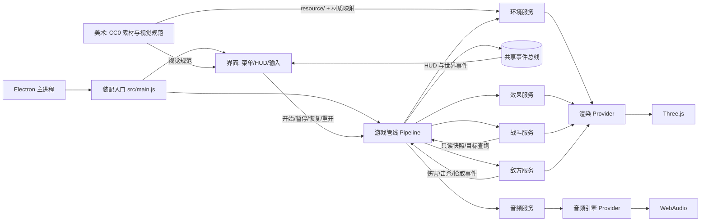

# DUSTLINE 总体架构

DUSTLINE 是一个 Electron + Three.js 的 Windows 桌面第一人称射击游戏：玩家在写实军事训练场中抵御人类士兵波次（步枪兵、重机枪手、突击兵）。本文件说明系统由哪些部分组成、各角色负责什么、公共契约在哪里，以及一次对局如何流动。具体功能流程由各角色自己的 `feature-map.md` 与 `docs/feature/` 维护。

## 1. 五层结构

```text
electron/main.js            Electron 窗口与生命周期（入口/装配）
index.html + src/main.js    页面骨架、装配入口、资源/设置接线
src/interface/              Interface：HUD、菜单、设置、输入、指针锁定
src/pipelines/              Pipeline：对局状态机、主循环、服务编排、计分/波次、设置转发
src/services/               Service：战斗（view-model）、敌人（human-visual）、竞技场/道具/贴片、效果、音频
src/providers/              Provider：Three.js 渲染、素材加载（含 GLB/HDR）、后处理、WebAudio
src/models/                 Model：共享配置、事件名、设置与契约（游戏管线唯一所有）
src/common/shared/          共享事件总线（项目管理唯一所有）
resource/                   CC0 贴图、HDRI、GLB（含人类士兵动画模型）、清单与授权（美术唯一所有）
```

调用方向严格为 `Interface → Pipeline → Service → Provider → 外部基础设施`。Model 由四层共享；Service 之间不互相导入，由 Pipeline 注入只读快照或转交事件。

## 2. 角色协作



| 角色 | 职责 | 功能导航 |
| --- | --- | --- |
| 项目管理 | 架构、契约评审、调度、共享事件总线 | 本文件、`docs/architecture/shared-components.md`、[feature-map](../角色卡/项目管理/feature-map.md) |
| 美术 | CC0 素材、授权、写实军事视觉规范 | [feature-map](../角色卡/美术/feature-map.md) |
| 游戏管线 | Model、状态机、主循环、计分/波次 | [feature-map](../角色卡/游戏管线/feature-map.md) |
| 战斗服务 | 玩家移动/跳跃/视角、武器、生命 | [feature-map](../角色卡/战斗服务/feature-map.md) |
| 敌方服务 | 波次、敌人 AI、弹丸、拾取 | [feature-map](../角色卡/敌方服务/feature-map.md) |
| 环境引擎 | 竞技场、效果、音频、全部 Provider | [feature-map](../角色卡/环境引擎/feature-map.md) |
| 界面装配 | HUD/菜单/输入、Electron、构建打包 | [feature-map](../角色卡/界面装配/feature-map.md) |
| 独立测试 | 跨角色集成、E2E、回归报告 | [feature-map](../角色卡/独立测试/feature-map.md) |

## 3. 一次对局的数据流

1. Electron 启动窗口，`src/main.js` 创建渲染 Provider、素材加载 Provider（贴图/HDRI/GLB）、音频引擎与各 Service；等待竞技场、敌方人类模型与战斗视图模型加载，再创建 Pipeline 和界面。
2. 菜单状态：Pipeline 只推进 O3 环绕镜头；界面显示标题、人类士兵作战简报、操作说明、设置入口、开始按钮与素材授权说明。
3. 玩家点击“开始”：界面锁定指针并调用 `game.start()`；Pipeline 重置战斗/敌人/波次/计分，进入 `playing`，发出 `game:state` 与首波 `hud:banner`。
4. 每帧：`src/main.js` 调用 `game.update(dt)`（dt 上限 0.05 秒），再调用渲染 Provider 的 `render()`（高画质经 SSAO/Bloom/分级/AA 后处理，低画质直接渲染）。Pipeline 读取输入快照，驱动战斗与敌人 Service，推进波次，发布 `hud:update`。
5. 射击：战斗服务用高细节视图模型和命中目标查询（敌方服务提供 `listHittable/applyDamage`）做射线判定；头/身命中盒区分爆头，爆头伤害 2 倍；命中/击杀通过事件回到 Pipeline 计分与 HUD，效果服务绘制血雾/弹孔/曳光，音频服务播放分层枪声/爆头提示。
6. 受伤/死亡：敌方人类士兵发出 `world:enemy-shot` 与 `player:damage { amount, sourcePosition }`，Pipeline 调用战斗服务 `damagePlayer` 并发布带方向的 `hud:damage`；生命归零后进入 `over` 并发布 `hud:gameover`。
7. ESC 或指针锁定丢失：界面调用 `game.pause()`；暂停期间业务时间冻结、渲染继续。继续调用 `game.resume()`，重开调用 `game.restart()`。设置面板可随时修改灵敏度/ADS/FOV/音量/画质，经 Pipeline `applySettings` 下发并保存在本地。

## 4. 公共契约

冻结契约与逐字段说明见 `docs/scheduling/neon-strike-delivery.md` §3。摘要：

| 契约 | 所有者 | 位置 |
| --- | --- | --- |
| 事件名、HUD 载荷、设置与性能快照 | 游戏管线 | `src/models/events.js`、`contracts.js` |
| 游戏数值、人类敌人配置、波次公式、设置默认/范围 | 游戏管线 | `src/models/game-config.js` |
| InputCommand、PlayerSnapshot、命中目标查询、Settings | 游戏管线 | `src/models/contracts.js` |
| 事件总线 | 项目管理 | `src/common/shared/event-bus.js` |
| 渲染/素材/音频 Provider | 环境引擎 | `src/providers/public/` |
| 战斗/敌方/竞技场/效果/音频 Service | 各 Service 角色 | `src/services/public/` |
| 对局公共入口 `createGame` | 游戏管线 | `src/pipelines/public/game.js` |
| 素材清单与授权 | 美术 | `resource/asset-manifest.json`、`resource/ATTRIBUTIONS.md` |

## 5. 当前实施状态（v3）

截至 2026-10-17 v3 交付构建：

- 已实现：人类士兵（步枪兵/重机枪手/突击兵，Quaternius CC0 GLB + 程序化战术装具 + 骨骼动画 + 头/身命中盒 + 爆头 + 死亡淡出）、高细节第一人称 AR-15/手套双手/视图动画、后坐/镜头滚转/FOV 冲击、分层枪声与命中反馈、场景道具/HESCO/沙袋/集装箱门/帐篷/探照灯/围栏/贴片、低角度阳光/长阴影/雾/尘土、SSAO/Bloom/色彩分级/SMAA/暗角/颗粒、低画质回退、设置面板（灵敏度/ADS/FOV/音量/画质，本地保存）、爆头/方向受击 HUD。
- 已验证：v3 集成测试 12/12、Electron E2E 4/4（ADS 黑镜修复后 E2E 5/5）、角色单元/契约测试 209/209（ADS 修复后战斗 65/65）；`npm run build` 通过（68 modules，ADS 修复后 JS `index-0WrKp_Kr.js` 1,009.43 kB，gzip 约 294 kB）；真实 Electron 完成菜单/开始/HUD/移动/射击/换弹/ADS/暂停/继续/死亡/重开、设置持久化、高/低画质切换；`npm run pack` 与 `npm run dist` 在 v3 源码上产出 `release/win-unpacked/DUSTLINE.exe` 与 `release/DUSTLINE Setup 1.0.0.exe`；ADS 黑镜修复后重新打包为 19:12/19:13（`index-0WrKp_Kr.js`，SHA-256 `6b8491f9…b971d`），解包应用 JS 与 `dist` 一致。
- 视觉验收：美术角色复核 v3 菜单/对局/HIP/ADS 截图，**静态方向通过**；武器聚合物材质阻塞已解决；保留三项非阻断打磨（敌方军服绿色/红帽偏饱和、HESCO 近处织纹、太阳 Bloom 略强）。截图：`test/项目管理/screenshots-v3/` 与 `test/独立测试/fixtures/screenshots-v3/`。
- 性能实测：1600×900 窗口、6 个步枪兵、高/低画质各 3 秒采样均约 180 fps（受 rAF/显示节奏限制，不能据此比较 GPU 开销，也不写成“60fps”）；30 敌人高画质未测量。
- 独立测试报告：`角色卡/独立测试/docs/reports/2026-10-17_report_initial-verification.md` §10（v3）；§1–§9 保留 v2 历史。
- 尚未验证：真人 2 波手感与听音、30 敌人高画质性能/输入延迟、连续重开 5 次内存、安装包安装/卸载/快捷方式、代码签名/图标、骨骼动画过渡/脚底滑动/装具穿插的逐帧观感、低画质与高画质的逐 pass 视觉对比。独立测试报告逐项区分通过与未运行。

功能文档入口：各角色 `feature-map.md`；本文件只描述跨角色结构与实际状态，不复制各角色的内部流程。
