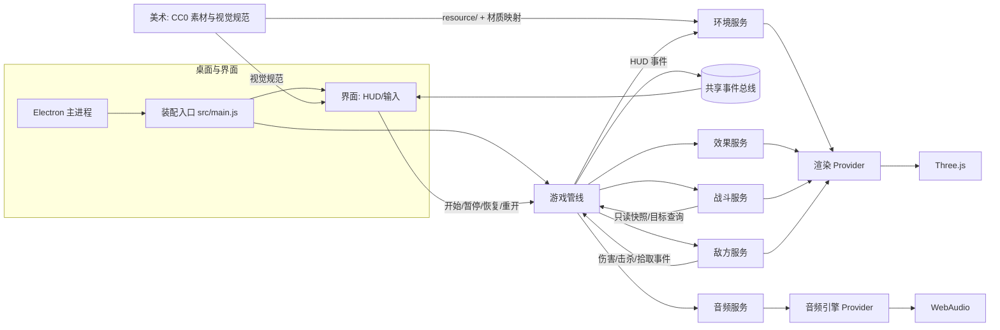
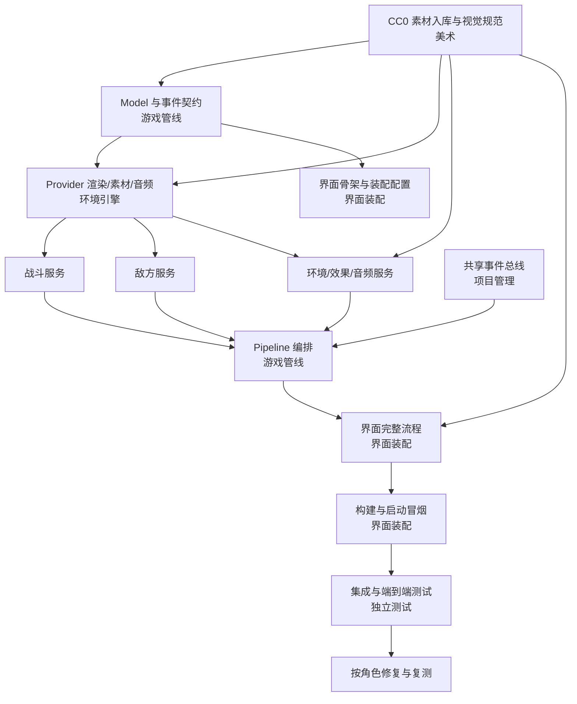

# DUSTLINE 桌面端写实军事 3D 射击游戏：引导与实施设计

- 文档版本：2026-10-17 / v3（人类士兵、射击手感与美术升级）
- 状态：已确认（2026-10-17，v3 全量升级）；v2 已交付，v3 为交付后的实质升级
- 负责人（实施后）：项目管理角色协调，各能力角色按边界实现
- 关联角色：项目管理、美术、界面装配、游戏管线、战斗服务、敌方服务、环境引擎、独立测试

## 1. 场景与目标

玩家双击桌面程序后，看到写实军事风格的 3D 训练场主菜单：阴天、尘土、混凝土掩体、集装箱与沙袋。点击“开始”后鼠标被锁定，玩家用 WASD 移动、鼠标瞄准、左键连续射击，在敌方机械单位的波次进攻中尽可能久地生存。敌人被击毁会得分，玩家受伤会掉血，生命归零后显示本局成绩并可以立即重开。

完成后应得到：

1. 可直接运行的 Windows 桌面程序（Electron 窗口，无需浏览器）。
2. 完整可玩的核心循环：菜单 → 对局 → 波次 → 受伤/死亡 → 结算 → 重开。
3. 可重复的构建、测试和打包命令。
4. 按 ANS 职责边界维护的角色文档、接口说明与测试证据。

当前 `index.html` 是 ANS 引导前创建的初始骨架，仅作为待替换的候选文件，不代表已实现。

## 2. 范围

### 2.1 核心范围（本次实施）

**玩家与操作**

- 第一人称移动：WASD、Shift 冲刺、Space 跳跃、鼠标视角（指针锁定）。
- 碰撞：竞技场边界、箱子/立柱/矮墙的 AABB 阻挡；可在平地跳跃。
- 生命 100，受伤后 5 秒未再受伤开始以 8/秒恢复；生命归零进入结算。
- ESC 释放鼠标并暂停；点击“继续”恢复；死亡后可重新开始。

**武器**

- 单把 AR 风格步枪：命中扫描（hitscan），按住左键自动射击。
- 射速 0.095 秒/发，弹匣 30 发，换弹 1.5 秒，备弹无限；空仓自动换弹，R 手动换弹。
- 基础伤害 26；命中敌人光学核心造成 2 倍伤害。
- 腰射散布 0.012 弧度，移动时略微增大；后坐力有镜头抬升并自动回正。
- 第一人称武器模型、枪口闪光、弹道线、命中火花；HUD 显示弹药和换弹进度。
- 写实比例与材质：哑光金属机匣、聚合物护木、磨损涂层；优先评估 CC0 步枪 GLB，若低多边形观感明显不足则采用程序化高细节步枪，并套用本设计的 PBR 材质。

**敌人与波次**

| 类型 | 生命 | 速度 | 行为 | 攻击 | 分值 |
| --- | --- | --- | --- | --- | --- |
| Drone 无人机 | 50 | 6.0 | 保持 8–12 米，侧向游走 | 单发能量弹，8 伤害 | 100 |
| Brute 重装 | 170 | 2.8 | 保持 5–9 米，缓慢逼近 | 三发扇形能量弹，每发 12 伤害 | 250 |
| Wraith 幽影 | 65 | 7.6 | 快速贴身 | 接触伤害 12，1.2 秒冷却 | 150 |

- 第 n 波敌人数：`min(4 + round(1.8n), 32)`；生成间隔 0.55 秒；波次间隔 4.5 秒。
- 第 1 波仅 Drone；第 2 波起出现 Brute（约 20%）；第 3 波起出现 Wraith（约 25%）。
- 每波敌人生命 +10%、伤害 +5%、速度 +2%，生命最多 3 倍、速度最多 +25%、伤害最多 2 倍。
- 敌人从竞技场边缘 22–28 米生成，距玩家至少 10 米，且不生成在障碍物内部。
- 敌人死亡有 18% 概率掉落生命球，拾取恢复 30 生命，25 秒后消失。
- 敌人受击闪白，死亡爆炸并产生碎片；Drone/Brute 有血条，受伤后显示。
- 敌人造型统一为军用机械单位（客户 2026-10-17 确认）：哑光金属、磨损涂装、红色光学核心；不采用人类士兵模型与骨骼动画。

**场景与氛围（写实军事）**

- 60 × 60 米户外训练场：尘土/碎石地面、混凝土地堡与隔离墙、波纹钢集装箱、木箱、金属桶、沙袋掩体、警戒塔与围栏。
- 阴天/部分多云 HDRI 天空与自然日光，柔和阴影、远景雾、漂浮尘土与风感。
- 低饱和军用色调：橄榄绿、卡其、混凝土灰、锈迹与磨损；不使用霓虹灯和发光网格。
- CC0 PBR 贴图（颜色、法线、粗糙度、金属度、AO）与程序化几何；HDRI 用于环境反射和天光。
- ACES 色调映射、电影感轻微暗角与颗粒（CSS 叠加），不使用外部后处理库。

**界面（PUBG 取向的军用 HUD）**

- 主菜单：标题 `DUSTLINE`、军用简报式排版、操作说明、开始按钮、素材授权说明。
- HUD：顶部中央罗盘条（随视角转动）、左上击杀信息、右上得分/波次、底部中央生命条、右下弹药、准星（随散布变化）、命中标记、换弹条、低血量与受伤红色边缘。
- 暂停界面、死亡结算（得分/波次/击杀/存活时间）、重新开始。
- 中文界面，桌面分辨率优先，窗口默认 1600 × 900。
- 视觉风格：半透明深色面板、细边框、无大面积发光；字体使用 Windows 自带的 Bahnschrift / Segoe UI 等宽组合。

**音频**

- WebAudio 程序化合成，无外部音频文件：射击、命中、击杀、换弹、空仓、受伤、爆炸、拾取、波次开始、游戏结束、风声与低频环境底噪。
- 开始按钮点击后初始化音频；M 键静音。

**桌面与构建**

- Electron：窗口 1600 × 900，隐藏菜单栏，开启上下文隔离，关闭 Node 集成；F11 全屏。
- Vite 构建渲染进程，`base: './'` 以支持 `file://` 加载。
- 命令：`npm run dev`（浏览器调试）、`npm run build`、`npm start`（构建并启动 Electron）、`npm run pack`（生成未压缩 Windows 应用目录）。
- 目标平台：Windows x64；不包含 macOS/Linux 打包。

**质量与测试**

- 每个角色的纯逻辑用 Node 内置测试运行器 `node --test` 验证。
- 跨角色集成测试验证状态流和事件顺序。
- Electron 端到端测试从真实窗口验证“启动 → 菜单 → 开始 → HUD 出现”。
- 独立测试角色提交日期化报告，区分通过、失败、未运行。

### 2.2 非目标

- 不实现联机、排行榜、账号、存档、关卡编辑器、移动端触控、手柄支持、大逃杀模式、载具、物资拾取/背包系统。
- 不引入付费或商业素材；仅使用 CC0 免费素材（见 2.4）。
- 不做 macOS/Linux 安装包；不做自动更新。
- 不在本次加入新敌人类型或 Boss 战。

### 2.4 免费素材清单与授权

本项目只使用 CC0（公共领域）素材。素材文件由美术角色下载、校验并保存到 `resource/`，同时在 `resource/asset-manifest.json` 与 `resource/ATTRIBUTIONS.md` 记录路径、来源、作者、授权和下载日期。环境引擎实现素材加载与渲染消费，不直接决定素材来源。若下载失败，美术角色与环境引擎协商使用程序化纹理回退并如实记录，不影响可玩性。

| 用途 | 来源/资产 | 授权 | 下载地址 |
| --- | --- | --- | --- |
| 天空与反射 | Poly Haven · `kloofendal_48d_partly_cloudy_puresky`（1K HDR） | CC0 | `https://dl.polyhaven.org/file/ph-assets/HDRIs/hdr/1k/kloofendal_48d_partly_cloudy_puresky_1k.hdr` |
| 地面/碎石 | ambientCG · `Ground054`（1K JPG） | CC0 | `https://ambientcg.com/get?file=Ground054_1K-JPG.zip` |
| 混凝土 | ambientCG · `Concrete034`（1K JPG） | CC0 | `https://ambientcg.com/get?file=Concrete034_1K-JPG.zip` |
| 金属 | ambientCG · `Metal032`（1K JPG） | CC0 | `https://ambientcg.com/get?file=Metal032_1K-JPG.zip` |
| 木材 | ambientCG · `Wood066`（1K JPG） | CC0 | `https://ambientcg.com/get?file=Wood066_1K-JPG.zip` |
| 波纹钢 | ambientCG · `CorrugatedSteel009`（1K JPG） | CC0 | `https://ambientcg.com/get?file=CorrugatedSteel009_1K-JPG.zip` |
| 沙袋/帆布 | ambientCG · `Fabric084`（1K JPG） | CC0 | `https://ambientcg.com/get?file=Fabric084_1K-JPG.zip` |
| 步枪模型 | Poly Pizza · Quaternius `Rifle`（1534 三角面，GLB） | CC0 | `https://static.poly.pizza/da83f4f9-7a4e-4739-9033-79d688aa3b5e.glb` |

仅保留实际使用的贴图通道：颜色、法线（GL）、粗糙度、金属度、AO；解压后删除 `.blend`、`.usdc`、`.mtlx` 等无关文件与压缩包，控制安装包体积。素材压缩包按不可信数据处理：在独立空目录解压，不执行其中任何文件，只读取图片/模型。

### 2.3 可选增强项（需要客户逐项确认）

| 编号 | 项目 | 说明 | 代价 |
| --- | --- | --- | --- |
| O1 | 右键瞄准（ADS） | 按住右键拉近视野、降低散布和后坐力、武器居中 | 增加输入、镜头与武器动画，约 0.5 个战斗任务 |
| O2 | Windows NSIS 安装包 | 在 `npm run pack` 之外生成安装程序 | 需额外下载 NSIS 工具；网络受限时可能失败 |
| O3 | 菜单动态镜头 | 主菜单背景环绕展示竞技场 | 少量界面/渲染代码 |
| O4 | 自动化测试钩子 | 测试模式暴露只读状态接口供端到端测试使用 | 少量装配/界面代码，默认关闭 |

默认建议勾选 O1、O2、O3、O4；未获得明确选择的项目不实施。

**客户确认（2026-10-17）**：O1、O2、O3、O4 全部选择实施。

## 3. 角色与架构

### 3.1 五层映射

```text
入口/装配    electron/main.js、src/main.js、package.json、vite.config.js
Interface     index.html、style.css、HUD 与输入
Pipeline      对局状态机、主循环、服务编排、计分与波次协调
Service       战斗、敌人、环境、视觉反馈、音频编排
Provider      Three.js 渲染、素材加载、WebAudio 合成
Model         src/models/ 共享配置、事件名、数据结构（由游戏管线唯一负责）
Common        src/common/shared/event-bus.js（由项目管理负责）
Resource      resource/ CC0 贴图、HDRI、模型、清单与授权（由美术负责）
```

调用方向严格为 `Interface → Pipeline → Service → Provider → 外部基础设施`；Model 跨层共享；Service 之间不互相导入，由 Pipeline 注入契约或转交事件。

### 3.2 角色职责与写范围

| 角色 | 主要职责 | 关键写范围 |
| --- | --- | --- |
| 项目管理 | 架构、跨角色契约评审、调度、共享事件总线 | `src/common/shared/event-bus.js`、`test/项目管理/`、`docs/architecture.md`、调度记录 |
| 美术 | 写实军事方向、CC0 素材、授权、材质映射与视觉验收 | `resource/`、`test/美术/`、美术方向与资产文档 |
| 界面装配 | HUD/菜单/暂停/结算、输入、Electron 壳、构建打包 | `index.html`、`src/style.css`、`src/interface/`、`src/main.js`、`electron/main.js`、配置与脚本 |
| 游戏管线 | 共享 Model、状态机、主循环、服务编排、计分 | `src/models/`、`src/pipelines/`、`test/游戏管线/` |
| 战斗服务 | 玩家移动/跳跃/视角、武器、弹药、生命与死亡规则 | `src/services/{abstract,public}/combat.js`、`src/services/impl/combat/` |
| 敌方服务 | 波次、敌人 AI、弹丸、近战、命中登记、生命拾取 | `src/services/{abstract,public}/enemies.js`、`src/services/impl/enemies/` |
| 环境引擎 | 竞技场、视觉反馈、音频编排、渲染/素材加载/音频 Provider | 环境/效果/音频 Service 与全部 Provider 文件 |
| 独立测试 | 跨角色集成、完整流程、回归、测试报告 | `test/独立测试/` |

完整的文件级白名单见各角色 `boundary.md` 第 1 节。不在白名单中的文件默认只读。

### 3.3 角色协作图



### 3.4 功能归属

| 功能 ID | 名称 | 主要负责角色 | 说明 |
| --- | --- | --- | --- |
| `match-flow` | 对局生命周期与计分 | 游戏管线 | 菜单之外的状态机、波次推进、得分、死亡与重开 |
| `art-assets` | 写实军事素材与视觉规范 | 美术 | CC0 素材、授权清单、材质映射、视觉验收 |
| `player-combat` | 玩家移动与射击 | 战斗服务 | 移动、碰撞、视角、武器、生命 |
| `enemy-waves` | 敌人与波次 | 敌方服务 | 三类敌人、弹丸、近战、掉落 |
| `arena-and-feedback` | 竞技场、视觉与音效 | 环境引擎 | 场景、碰撞数据、粒子/弹道/爆炸、声音 |
| `match-interface` | 对局界面与输入 | 界面装配 | 菜单、HUD、暂停、结算、键鼠与指针锁定 |
| `desktop-shell` | 桌面启动与打包 | 界面装配 | Electron 窗口、构建、启动、打包 |
| 无 | 测试与报告 | 独立测试 | 无直接业务功能 |

## 4. 关键契约

所有契约的最终版本由游戏管线写入 `src/models/contracts.js`、`src/models/events.js`，并在各角色 `api-spec.md` 引用同一版本。以下为设计与实施必须遵守的语义。

### 4.1 输入命令 `InputCommand`

```js
{
  moveForward: -1 | 0 | 1,
  moveRight: -1 | 0 | 1,
  jump: boolean,          // 本帧刚按下
  sprint: boolean,
  fire: boolean,          // 按住
  aim: boolean,           // 按住右键（O1 启用时）
  reload: boolean,        // 本帧刚按下
  lookDeltaX: number,     // 像素
  lookDeltaY: number      // 像素
}
```

输入只由界面层产生；战斗服务消费后不保存输入对象本身。

### 4.2 玩家快照 `PlayerSnapshot`

```js
{
  x, y, z,             // 脚底位置，y=0 为地面
  eyeHeight,           // 1.68
  yaw, pitch,          // 弧度
  velocityX, velocityZ,
  health, maxHealth,
  alive: boolean
}
```

由 Pipeline 从战斗服务读取后传给敌方服务；敌方服务只读，不修改玩家状态。

### 4.3 命中目标契约

敌方服务向 Pipeline 提供：

```js
{
  listHittable(): [{ object, targetId }],       // object 为可射线检测的渲染对象
  applyDamage(targetId, damage): {
    hit: boolean,
    killed: boolean,
    critical: boolean,
    position, color, score, enemyType
  }
}
```

Pipeline 适配后注入战斗服务；战斗服务发射射线并调用 `applyDamage`，不导入敌方服务。命中核心（`userData.part === 'core'`）时由敌方服务返回 `critical: true`，战斗服务据此应用双倍伤害或在调用前乘算；实现时只允许一种方式，避免重复加倍。

### 4.4 游戏事件

Pipeline 通过共享事件总线发出，界面与音频/效果消费：

| 事件 | 载荷要点 | 消费方 |
| --- | --- | --- |
| `game:state` | `state: 'menu' \| 'playing' \| 'paused' \| 'over'` | 界面 |
| `hud:update` | `score, wave, kills, health, maxHealth, ammo, magazineSize, reloading, reloadProgress, yaw, muted` | 界面 |
| `hud:hitmarker` | `killed: boolean` | 界面 |
| `hud:killfeed` | `enemyType, score, critical` | 界面 |
| `hud:damage` | `amount` | 界面 |
| `hud:banner` | `title, subtitle, durationMs` | 界面 |
| `hud:gameover` | `score, wave, kills, survivedSeconds` | 界面 |
| `world:shot` | `from, to, muzzlePosition, color` | 效果服务 |
| `world:impact` | `position, normal, color` | 效果服务 |
| `world:explosion` | `position, color, scale` | 效果服务 |
| `world:enemy-spawn` | `position, color` | 效果服务 |
| `sound:*` | 由 Pipeline 直接调用音频服务的方法，不经总线 | 音频服务 |

界面不实现游戏规则，只呈现事件和发送命令。

### 4.5 Pipeline 公共入口

```js
createGame({ bus, renderer, environment, combat, enemies, effects, audio })
  → {
      start(), pause(), resume(), restart(), dispose(),
      update(deltaSeconds),          // 由内部主循环或测试调用
      getState(), getSnapshot()
    }
```

实现细节可在提案阶段调整，但界面只能依赖这些语义。暂停时 `update` 不推进业务时间，仍允许渲染层由装配或管线继续绘制。

### 4.6 Service 公共入口（概要）

- 战斗：`createCombat({ renderer, colliders, targetQuery, emit }) → { reset, update(dt, input), damagePlayer(amount), heal(amount), getSnapshot, dispose }`
- 敌方：`createEnemies({ renderer, colliders, getSpawnPoint, emit }) → { reset, startWave(n), update(dt, playerSnapshot), getTargetQuery, getState, dispose }`
- 环境：`createArena({ renderer }) → { getColliders, getSpawnPoint, getPlayerSpawn, update, dispose }`
- 效果：`createEffects({ renderer }) → { tracer, impact, explosion, spawn, update, clear, dispose }`
- 音频：`createAudio({ engine }) → { init, shoot, hit, explosion, hurt, reload, empty, pickup, waveStart, gameOver, setMuted, dispose }`

### 4.7 Provider 公共入口（概要）

- 渲染：`createRenderer({ canvas, width, height }) → { add, remove, attachToCamera, setCameraPose, getCameraPose, getWorldPosition, raycast, setEnvironment, resize, render, dispose }`
- 素材加载：`createAssetLoader() → { loadTexture(url, options), loadHdr(url), loadModel(url), dispose }`；资源路径以美术角色维护的 `resource/asset-manifest.json` 为准，环境引擎实现加载，其他角色不直接读取 `resource/`。
- Three.js 门面：`src/providers/public/three.js` 显式导出项目使用的类（`Vector3`、`Mesh`、`MeshStandardMaterial`、几何体、灯光等），禁止 `export *`。
- 音频引擎：`createAudioEngine() → { init, tone, noise, setMuted, setMasterVolume, dispose }`。
- 服务不得访问 `src/providers/impl/`；Provider 不得导入 Service/Pipeline/Interface。

### 4.8 时间与生命周期

- 主循环 `delta` 上限 0.05 秒，防止切换窗口后角色瞬移。
- 对局暂停时停止敌人、弹丸、玩家和波次计时；渲染继续。
- `restart()` 必须重置玩家、敌人、弹丸、拾取物、得分、波次和计时，并清理旧场景对象，避免重复叠加。
- 音频在用户手势后初始化；未初始化时调用音频方法应为安全空操作并记录一次警告。

## 5. 关键设计选择

1. **命中扫描而非真实弹丸（玩家武器）**：射击手感直接、判定清晰，且便于稳定测试。敌方使用可见慢速弹丸，给玩家躲避空间。代价是玩家子弹没有飞行时间，但符合街机射击风格。
2. **Three.js 作为 Provider 的公开渲染契约**：游戏内容大量使用 Three.js 几何体/材质。为避免在每层复制巨大包装 API，Provider 显式公开项目实际使用的 Three.js 符号和一个受控渲染上下文；服务仍只能导入 `src/providers/public/`，不接触实现细节。代价是 Provider 公共面较大，升级 Three.js 时需重新核对导出。
3. **服务之间通过 Pipeline 注入协作**：战斗与敌人互不导入，避免服务网状依赖；Pipeline 提供只读玩家快照与命中目标查询。代价是 Pipeline 需要维护适配层，但依赖方向清晰、可测试。
4. **事件总线承载 HUD 更新**：界面与 Pipeline 解耦，HUD 可独立测试。代价是事件载荷需要模型化并保持版本一致。
5. **外部 CC0 素材 + 程序化几何 + 合成音频**：贴图、HDRI 与可选步枪模型来自 CC0 素材库，由独立美术角色负责来源、授权、材质映射与视觉验收；场景结构、敌人与特效仍用程序化几何，音频继续用 WebAudio 合成。这样能获得接近写实军事的材质与光照，同时避免付费资产和重型后处理。代价是资源下载可能受网络影响，并需要额外维护授权清单与资源体积。
6. **独立美术角色**：视觉不是实现角色的附带产物。美术角色拥有素材与视觉规范，环境引擎和界面装配负责实现；出现视觉偏差时由美术提出可验收的修改项，减少“工程能跑但画面不对”的风险。
7. **Electron + Vite**：现有 Node 环境可直接开发、打包为桌面程序，并保留浏览器调试能力。代价是安装包体积较大（Electron 运行时）。

## 6. 实施顺序与依赖



约束：

1. 美术素材与视觉规范先于环境/战斗/界面的材质实现；素材缺失时使用程序化回退，并记录。
2. Model/事件契约先于依赖它的服务实现。
3. Provider 公共入口先于 Service；Service 先于 Pipeline；Pipeline 先于完整界面接入。
4. 共享事件总线可在 Model 之后、Pipeline 之前实现并测试。
5. 界面装配可先搭 Electron 壳与构建配置，但完整界面必须等 Pipeline 公共入口可用。
6. 独立测试至少等装配冒烟通过后执行完整流程。
7. 任何跨角色契约变化由游戏管线报告项目管理，重新评审并使旧证据失效。

## 7. 验证方案

### 7.1 分层测试

| 角色 | 必须验证 |
| --- | --- |
| 项目管理 | 事件总线订阅/退订、重复订阅、异常处理器隔离 |
| 美术 | 资产清单字段、文件存在、授权记录、必要贴图通道与路径 |
| 游戏管线 | 状态迁移、计分、暂停不推进时间、死亡结算、重开复位、HUD 事件顺序 |
| 战斗服务 | 圆-AABB 推移、移动方向、弹药/换弹状态、伤害与恢复、命中核心伤害计算 |
| 敌方服务 | 波次数量与类型分布、缩放上限、生命扣除、击杀分值、拾取触发 |
| 环境引擎 | 布局碰撞、出生点不在障碍/边界内、效果池复用、音频参数映射 |
| 界面装配 | HUD 数值/事件展示、开始/暂停/恢复按钮命令、窗口启动 |
| 独立测试 | 跨角色状态流、Electron 完整流程、回归 |

### 7.2 集成与端到端

1. 用真实模块 + 假渲染 Provider 运行 Pipeline，确认菜单外开始、波次推进、玩家受伤、死亡与重开。
2. Electron 冒烟：启动窗口，页面标题为 `DUSTLINE · 尘埃战线`，canvas 存在，开始按钮可见。
3. 点击开始：HUD 出现、菜单隐藏、对局状态变为 playing。
4. 完整流程（人工或 O4 测试钩子）：移动、射击并击杀至少一个敌人、暂停/继续、死亡、重开。
5. 视觉检查：HDRI 天光与环境反射生效，地面/混凝土/金属/木材/帆布贴图可辨认，整体为低饱和军用色调且无霓虹元素。
6. 构建：`npm run build` 成功；`npm start` 能启动桌面窗口；`npm run pack` 生成可运行应用目录。

### 7.3 性能与稳定性

- 目标：1600 × 900 窗口，30 个敌人 + 弹丸 + 效果时仍可交互；记录实际观察值，不承诺未测量的帧率。
- 连续开始/重开 5 次，确认场景对象数量与内存不持续增长。
- 切换窗口导致指针锁定丢失时，游戏进入暂停而不是继续受伤。

### 7.4 验收条件

- 玩家能在桌面窗口中完成一局：开始、移动、射击、击杀、推进至少 2 波、暂停恢复、死亡结算、重开。
- 画面呈写实军事风：PBR 贴图、HDRI 天光、自然阴影与低饱和军用色调可实际观察，无霓虹残留。
- `resource/asset-manifest.json` 与 `resource/ATTRIBUTIONS.md` 完整，所有 CC0 素材来源可追溯。
- 核心范围中的每个“必须验证”项有实际运行结果。
- 构建与启动命令在 Windows 11 上实际执行成功。
- 角色文档、接口说明与测试报告齐全，并明确列出未实现/未验证项。

## 8. 风险与处理

| 风险 | 影响 | 处理 |
| --- | --- | --- |
| Electron/打包工具下载受限 | 无法生成安装包 | 先保证本地 `npm start` 与 `npm run pack`；安装包 O2 失败时保留退路并如实报告 |
| CC0 素材站点不可达或链接失效 | 素材缺失、画面退回程序化纹理 | 美术角色保留已知可用镜像与本地清单；失败时启用程序化回退，记录来源和影响 |
| 低多边形步枪 GLB 观感不足 | 武器与写实环境不协调 | 以实际截图评估；不达标时改用程序化高细节步枪并复用 PBR 材质 |
| 素材授权记录不完整 | 发布风险 | 仅使用 CC0；清单与授权文件作为验收条件，独立测试角色核对 |
| WebGL 在目标机器性能不足 | 帧率低、操作不跟手 | 降低阴影/粒子数量，1K 贴图与有限点光；记录实际测量 |
| 指针锁定或自动化在测试环境不稳定 | E2E 无法模拟完整操作 | 冒烟测试以 HUD/状态可见为准；完整操作由 O4 测试钩子或人工验证补充 |
| 跨角色契约不一致 | 集成失败 | Model 由单一角色负责；契约变更强制通知与复测 |
| 多个角色并行写冲突 | 文件被覆盖 | 写集合按文件白名单隔离；不同阶段遵循依赖顺序 |
| 范围过大导致半成品 | 无法交付 | 先完成核心范围与桌面可运行，再考虑可选增强项 |

## 9. 交付与运行

实施完成后提供：

- `npm run dev`：Vite 浏览器调试（可选）。
- `npm start`：构建并启动 Electron 桌面窗口。
- `npm run pack`：生成 Windows 未压缩应用目录。
- 可选的 `npm run dist`：生成 NSIS 安装包（O2）。
- `resource/ATTRIBUTIONS.md` 与 `resource/asset-manifest.json`：素材来源与授权。
- 操作说明与已实现/未实现清单；测试报告链接。

## 10. 批准请求（v2）

请客户确认：

1. 本设计文档 `2026-10-17 / v2`（写实军事美术 + CC0 素材策略）。
2. 第 3 节的角色划分与各角色第 1 节边界白名单，包括新增的“美术”角色及其 `resource/` 写范围。
3. 核心范围（第 2.1 节）与素材清单（第 2.4 节）。
4. 可选增强项 O1–O4（v1 已选择全部实施，本版不变）。
5. 项目管理按上述依赖顺序自动向独立角色上下文分派实施任务（v1 已授权，本版不变）。

确认方式：在聊天中明确写出“确认 v2 设计、美术角色边界，并按核心范围与 O1–O4 继续实施”。未得到此确认前，不写入应用代码。

## 11. 批准记录

- 2026-10-17：客户通过选择确认本设计文档（v1）、7 个角色的文件边界白名单与核心范围。
- 可选增强：O1 右键瞄准、O2 Windows NSIS 安装包、O3 菜单动态镜头、O4 自动化测试钩子，全部批准。
- 执行方式：批准项目管理按依赖顺序自动向独立角色上下文分派实施任务。
- 2026-10-17：客户要求美术类似 PUBG，并选择使用免费素材；据此新增独立“美术”角色，美术方向改为写实军事 + CC0 素材。
- 2026-10-17：客户确认 v2 设计与 8 个角色边界，并确认敌人采用军用机械单位，不采用人类士兵模型；维持 O1–O4 与自动分派授权。
- 2026-10-17：v2 已交付（DUSTLINE v1.0.0）。随后客户要求：不再攻击无人机、改为攻击人类士兵；完成三项美术打磨；重做射击手感与美术质量。据此提出 v3 升级提案（第 12 节）。
- 2026-10-17：客户确认 v3 全量升级：人类士兵、射击手感重做、三项美术打磨、场景/后处理与设置面板。实施范围与第 12 节一致。
- 说明：本记录仅补充批准状态，不改变第 2–9 节的设计内容。之后若发生实质性范围或设计变更，需重新提交确认。


## 12. v3 修订：人类士兵、射击手感与美术升级（待确认）

### 12.1 背景与目标

v2 交付后客户反馈：不要再打无人机，要打“人”；三项美术打磨；射击手感与美术整体“太 low”。v3 的目标不是增加玩法，而是把敌人、反馈和画面质量提升到接近写实军事射击的水准。

**诚实边界：** 免费且授权清晰、带完整持枪/奔跑/死亡动画的真人模型以低多边形为主。v3 会使用 Quaternius 的 CC0 动画人类模型，加上战术装备、PBR 材质、骨骼动画、后处理与更密集的场景细节；观感会显著提升，但不会达到 PUBG 的照片级角色与场景。如果客户要求照片级，需要采购高精度角色/场景资产并延长工期。

### 12.2 敌人：人类士兵

三类敌人保留原玩法定位，外观与动画改为人类士兵：

| 类型（HUD 名称） | 基础模型 | 生命 | 速度 | 行为 | 攻击 | 分值 |
| --- | --- | --- | --- | --- | --- | --- |
| 步枪兵 Rifleman | Adventurer | 70 | 5.0 | 保持 9–16 米，侧向移动，短点射 | 步枪弹，7 伤害 | 100 |
| 重机枪手 Heavy Gunner | Adventurer（放大 1.12，重甲） | 200 | 2.8 | 缓慢逼近 6–10 米，持续压制 | 三连发，每发 11 伤害 | 300 |
| 突击兵 Breacher | Man 基础模型（近战） | 85 | 7.2 | 快速贴身 | 拳击/近战，14 伤害 | 150 |

- 使用 Quaternius 动画片段：`Idle_Gun`、`Walk`、`Run`、`Run_Shoot`、`Gun_Shoot`、`HitRecieve`、`Death`；突击兵使用 `Punch_Left/Right`、`Run`、`Walk`、`Death`。
- 模型统一加装：头盔、面罩、防弹背心、弹匣袋、护膝、手套、步枪；重机枪手增加肩甲/护板并放大；突击兵不持长枪，使用近战动作。
- 命中部位：头部命中 2 倍伤害（爆头），身体普通伤害；使用独立头/身命中盒，不直接对骨骼网格做逐三角射线检测。
- 受击播放 `HitRecieve`；死亡播放 `Death`，尸体保留 4 秒后淡出；死亡后立即移出可命中列表。
- 敌人开火有枪口闪光、曳光弹、枪声与投射物；换弹期间停止射击并显示动作（至少头部/武器动作）。
- 敌人朝向玩家；移动、射击、受击、死亡状态使用 AnimationMixer 交叉淡入淡出，避免瞬切。
- 场景中不再出现无人机、幽影等机械敌人；HUD 击杀信息使用“步枪兵/重机枪手/突击兵”。

### 12.3 射击手感重做

**武器视图**

- 重建高细节 AR-15 风格步枪：上/下机匣、护木、枪管、导气块、准星、红点镜、拉机柄、抛壳口、弹匣、枪托、握把、扳机护圈、枪口制退器、导轨与磨损。
- 增加第一人称戴手套的双手与战术袖口；右手握把、左手护木，随射击/换弹/冲刺做对应动作。
- PBR 金属/聚合物材质，暗部与护木分离，增加边缘磨损；不再使用当前的“黑色板砖”外观。
- 视图动画：待机呼吸、行走摆动、冲刺收枪、ADS 过渡、射击后坐、换弹（弹匣落下/插入/拉机柄）、抛壳、枪口烟雾与闪光。

**镜头与反馈**

- 连射后坐模式：垂直抬升 + 轻微水平漂移 + 镜头滚转，松手后平滑回正；ADS 降低后坐与散布。
- 每发有 FOV 冲击、轻微镜头震动、准星扩散与恢复；击杀时短暂顿帧/音效强调。
- 命中敌人：受击动画、命中血雾/尘土、爆头专用命中标记与音效；击杀出现击杀信息与分数。
- 弹道：曳光弹、世界命中火花/尘土、弹孔贴片；换弹时弹匣/弹壳有可见动画与声音。
- 敌人投射物保留可见曳光，给玩家躲避空间。

**音效**

- 枪声分层：高频爆裂、低频枪身、尾部回声；每发随机微调，避免机械重复。
- 换弹机械声、弹壳落地、空仓击针、命中/爆头/击杀提示、脚步、冲刺呼吸、环境风声与远处交火。
- 音量、静音、以及主菜单/暂停中的设置项。

**设置项**

- 鼠标灵敏度、ADS 灵敏度倍率、视野 FOV、主音量、画面质量（高/低，控制后处理）。
- 设置保存在本地，开始对局后生效；O4 测试钩子可读取当前设置。

### 12.4 美术升级

1. 完成 v2 遗留三项：沙袋使用真实 Fabric084 颜色贴图的保亮度卡其重映射并保留织纹；步枪暗部与聚合物护木分离；降低木箱红色饱和度。
2. 场景细节：Hesco/混凝土隔离墩、独立沙袋墙、集装箱门与锁杆、木箱板条、金属桶箍、托盘、轮胎、帐篷、警戒塔、围栏/铁丝网、警示牌、弹药箱、探照灯、地面碎石/草丛/杂物与污渍贴片。
3. 光照与氛围：更明确的低角度阳光与长阴影、灰尘粒子、体积感雾、更丰富的天空背景；保留阴天/晨昏军事色调。
4. 后处理：SSAO 环境遮蔽、Bloom（枪口/灯光）、色彩分级（低饱和、暖高光/冷暗部）、FXAA/SMAA、暗角与轻微颗粒；提供低画质回退。
5. HUD/菜单：爆头/击杀提示、方向受击指示、更清晰的罗盘与击杀信息、武器/敌人名称；菜单保持写实军事简报风。
6. 性能目标：1600 × 900、高画质下可交互；记录实际帧率；低于可接受值时自动/手动关闭 SSAO 或降低阴影。

### 12.5 新增素材（全部 CC0）

| 用途 | 资产 | 授权 | 地址 |
| --- | --- | --- | --- |
| 步枪兵/重机枪手 | Quaternius `Adventurer` | CC0 1.0 | `https://static.poly.pizza/bbe369ee-a686-42c7-adad-14356f5f2f15.glb`；来源页 `https://poly.pizza/m/5EGWBMpuXq` |
| 步枪兵变体 | Quaternius `Animated Woman`（Casual） | CC0 1.0 | `https://static.poly.pizza/ba7a1955-ea51-4cb9-a561-188bdef0a6c7.glb`；来源页 `https://poly.pizza/m/qJ2gsTUBHL` |
| 步枪兵变体 | Quaternius `Animated Woman`（Formal） | CC0 1.0 | `https://static.poly.pizza/46d6db5a-3c9f-4238-8cdf-8eb7194498dc.glb`；来源页 `https://poly.pizza/m/nIItLV9nxS` |
| 突击兵 | Quaternius `Man`（基础人类） | CC0 1.0 | `https://static.poly.pizza/3746be88-6799-4817-929b-6bc067c47caa.glb`；来源页 `https://poly.pizza/m/HMnuH5geEG` |

- 这些 GLB 自带骨骼、材质与动画；美术角色负责验证动画名、尺寸、朝向、根运动与授权，写入 `resource/asset-manifest.json` 与 `ATTRIBUTIONS.md`。
- 武器仍由程序化几何构建，使用现有 CC0 PBR 贴图；不新增付费或来源不明素材。
- 若运行中确认某个模型存在严重的根运动、比例或绑定问题，环境/敌方角色报告项目管理，由美术角色决定替换为另一 CC0 变体；不得擅自使用非 CC0 模型。

### 12.6 代码与角色边界变更

新增/调整文件（具体白名单以各角色 `boundary.md` 与 `.ans/project.json` 为准）：

| 角色 | 新增/调整 |
| --- | --- |
| 美术 | `resource/models/quaternius-adventurer.glb`、`quaternius-woman-casual.glb`、`quaternius-woman-formal.glb`、`quaternius-man-base.glb` |
| 战斗服务 | `src/services/impl/combat/view-model.js`（高细节步枪/双手/视图动画）及对应测试 |
| 敌方服务 | `src/services/impl/enemies/human-visual.js`（GLB 加载、装备、动画、命中盒）及对应测试 |
| 环境引擎 | `src/services/impl/environment/props.js`、`decals.js`、`src/providers/impl/post-processing.js` |
| 界面装配 | `src/interface/impl/settings.js`（灵敏度/FOV/音量/画质）及对应测试 |
| 游戏管线 | `game-config` 增加设置默认值与敌人配置；Pipeline 增加 `applySettings()`/`getSettings()`，转发给战斗/渲染/音频 |
| 独立测试 | 更新集成与 E2E：人类敌人、爆头、射击反馈、设置、画面截图 |

相邻层规则不变：Interface → Pipeline 公共入口；Pipeline → Service 公共入口；Service → Provider 公共入口；禁止 Service 互导和跨层 `impl/` 导入。

### 12.7 验收

- 游戏中不再出现无人机/机械敌人；三类人类士兵能生成、移动、持枪/近战、受击、死亡，且动作不瞬切。
- 爆头有 2 倍伤害、专用命中标记/音效；身体命中与击杀反馈清晰。
- 射击有明确后坐、镜头反馈、枪口闪光/烟雾、抛壳、换弹动画与分层枪声；手感设置可调。
- 三项美术打磨完成；场景细节与后处理实际可见；截图对照 v2 有明显提升。
- 设置项（灵敏度/FOV/音量/画质）保存并在对局中生效；低画质可关闭后处理。
- `npm run build`、角色单元测试、集成测试、Electron E2E 全部通过；生成新的 `win-unpacked` 与 NSIS 安装包；更新独立测试报告与截图。
- 如实记录未验证项（真人长时间手感/听音、30 敌人 + 高画质性能、安装包安装卸载等）。
