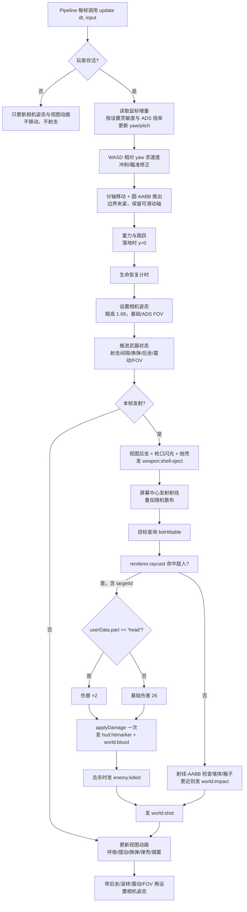

# 玩家移动与射击

## 这个功能解决什么问题

玩家进入对局后，需要一个能走动、能瞄准、能开枪的第一人称身体：WASD 移动、Shift 冲刺、Space 跳跃、鼠标看四周，撞到箱子或墙会停下并沿墙滑动；被敌人打中会掉血，停火 5 秒后缓慢回血，生命归零就死亡；按住左键能用一把 AR 步枪连续射击，打空弹匣自动换弹，也可以按 R 手动换弹。

v3 起，第一人称武器不再是简单的黑色方块：它是一把带机匣/护木/枪管/红点镜/弹匣/枪托/握把/枪口制退器等细节的 AR-15 风格步枪，画面里还能看到戴手套的双手和战术袖口。射击有后坐、镜头滚转、震动、FOV 冲击、枪口闪光/烟雾与抛壳；换弹时弹匣会落下再插入，拉机柄会拉动。命中敌人头部造成 2 倍伤害。

这个功能只负责“玩家这一侧”的规则和表现。敌人是否存在、命中后扣多少血、得分和波次由敌方服务与 Pipeline 决定；弹道线、火花、血雾和音效由环境引擎的反馈/音频服务根据事件绘制。

## 玩家现在能做什么

- **移动**：WASD 相对当前视角方向移动，默认速度 5.6 米/秒；按住 Shift 变为 1.55 倍；右键瞄准时速度降到 0.6 倍。
- **跳跃**：只有脚踩地面（y = 0）时按 Space 才起跳，起跳速度 6.2 米/秒，重力 20 米/秒²。
- **碰撞**：玩家按半径 0.45 米的圆处理，撞到竞技场边界或 AABB 箱子/墙时会被推出；斜向撞墙时沿墙滑动，不会完全卡死。
- **视角**：鼠标水平移动改变朝向，垂直移动改变俯仰，俯仰限制在 ±1.55 弧度；眼高 1.68 米。灵敏度由设置控制，ADS 时再乘 ADS 灵敏度倍率。
- **生命**：满血 100；受伤后 5 秒内不恢复，之后以 8/秒恢复到上限；治疗（生命球）不会超过上限。
- **死亡**：生命归零后 `alive = false`，只发一次 `player:died`；死亡期间不能移动或射击。调用 `reset()` 后满血复活、武器满弹匣、视角回到出生朝向。
- **射击**：按住左键每 0.095 秒发射一发，弹匣 30 发，伤害 26；命中敌人头部时伤害先乘 2（52），且只乘一次。
- **换弹**：弹匣打空会自动换弹，也可以按 R 手动换弹；换弹 1.5 秒，备弹无限，进度可供 HUD 显示。
- **散布与后坐力**：腰射散布 0.012 弧度，移动时增加 0.006；右键瞄准时散布 ×0.35。每发有垂直抬升、轻微水平漂移和镜头滚转，按指数平滑回正；ADS 把三者和 FOV 冲击都调小。
- **镜头反馈**：每发有 FOV 冲击、轻微镜头震动与滚转；相机姿态通过 `setCameraPose` 传递 `roll`、`shakeX`、`shakeY` 与 `fovPunch`。
- **第一人称武器**：程序化高细节 AR-15，挂在相机下，腰射在右下，瞄准时居中抬高；冲刺时下压倾斜。基础缩放 0.85 在视图层再乘 0.82（最终 0.697），腰射约占画面右下 27% 宽、40% 高，ADS 时红点镜居中且不遮挡左侧。护木/弹匣/握把/枪托使用聚合物 `#262420`；手套/袖口/木材只使用织物/木材的法线/粗糙度，不套用蓝色 Fabric084 / 偏红 Wood066 颜色图，因此不会出现蓝紫或酒红色块。红点镜是四面薄壁围成的开放隧道，镜片低不透明度且不写深度，中心有高亮红点，ADS 时能透过镜框看到场景。开火时显示暖色枪口闪光与烟雾，并抛出一枚受重力影响的弹壳。
- **双手**：右手握把、左手护木，戴深色手套、穿卡其战术袖；随武器后坐、ADS、冲刺与换弹动作移动。
- **设置**：`setSettings({ mouseSensitivity, adsSensitivityMultiplier, fov })` 校验并夹紧后应用；`getSettings()` 返回冻结副本。
- **菜单显隐**：Pipeline 可以在主菜单调用 `setViewVisible(false)` 隐藏整个第一人称视图，避免遮挡 O3 菜单场景；进入对局调用 `setViewVisible(true)` 或 `reset()` 恢复可见。默认可见。
- **素材**：如果装配传入 `assets`，`await load()` 会预加载金属/钢/木材/织物 PBR 贴图；未提供或失败时使用程序化材质，并在控制台记录一次。

## 当前流程



换弹与空仓在武器状态机里处理：手动换弹优先于本帧开火；最后一发打空时发 `weapon:empty` 并开始自动换弹；换弹完成发 `weapon:reload-end`。视图模型根据换弹进度显示弹匣下落、弹匣插入和拉机柄三个阶段。

主菜单不调用 `update`。Pipeline 可在菜单状态调用 `setViewVisible(false)`，对局开始后调用 `reset()`（会恢复视图可见）或显式 `setViewVisible(true)`。

## 事件

| 事件 | 何时发出 | 载荷要点 |
| --- | --- | --- |
| `world:shot` | 每次开火 | `{ from, to, muzzlePosition, color }` |
| `world:impact` | 命中墙体/箱子 | `{ position, normal, color }` |
| `world:blood` | 命中敌人（含击杀） | `{ position, direction, color }` |
| `weapon:shell-eject` | 每次开火 | `{ position, velocity }` |
| `hud:hitmarker` | 命中敌人 | `{ killed, headshot }` |
| `enemy:killed` | 击杀敌人 | `{ enemyType, score, headshot, critical, position, color }` |
| `player:died` | 生命第一次归零 | `{}` |
| `weapon:reload-start` | 开始换弹 | `{ durationSeconds }` |
| `weapon:reload-end` | 换弹完成 | `{}` |
| `weapon:empty` | 弹匣打空 | `{}` |

`hud:damage` 不由战斗服务发出。敌方服务发 `player:damage { amount, sourcePosition? }`，Pipeline 调用 `damagePlayer(amount)` 后统一发布一次带方向的 `hud:damage`，避免重复受伤闪烁。

## 已实现与未验证

### 已实现并有自动测试

- 圆-AABB 四个方向的推出、斜向盒角推出、盒内最短边推出、多障碍迭代不穿透。
- 斜向撞墙滑动、竞技场边界夹紧、身体高于障碍时通过。
- 射线-AABB 命中/错开/最近障碍/射程限制；散布方向偏移不超过给定角且保持单位长度。
- 射击间隔、弹匣耗尽、空仓提示、自动与手动换弹、换弹进度。
- 伤害 26、爆头 52（严格 2 倍且只乘一次，倍率来自 `GAME_CONFIG.enemies.headshotMultiplier`）。
- 移动/瞄准对散布的影响；垂直/水平/滚转后坐力、指数回正、ADS 削弱、镜头震动、FOV 冲击。
- 玩家相对视角移动、冲刺、跳跃与落地、受伤/恢复/治疗上限/死亡/复位。
- 设置夹紧、鼠标灵敏度/ADS 灵敏度/FOV 生效、`getSettings` 冻结副本。
- `createCombat` 缺少依赖或素材加载器不完整时报错；快照字段完整；爆头/身体/墙体事件与伤害；更近的墙体阻挡敌人伤害；死亡事件只发一次且不直接发 `hud:damage`；reset 可重复调用；dispose 幂等。
- `setViewVisible` 显隐视图、非法输入抛错、reset 恢复可见；调优后的整体缩放与腰射位置固定。
- 屏幕空间范围：腰射可见包围盒只落在画面右下（约 27% 宽、40% 高），不越过画面中心；ADS 红点镜水平居中、整体宽度不超过 20%；腰射与 ADS 都没有部件贴近/穿过近裁剪面。
- 红点镜结构：四面薄壁围成开放隧道、中心无实心盒；镜片透明、低不透明度且不写深度；红点颜色 `#FF2A1F`、`toneMapped: false`、`depthWrite: false`，靠近镜片中心；ADS 相机到镜框距离 > 0.2 米。
- `load()` 无素材时幂等完成；有素材时只加载一次清单并预加载四组颜色贴图。
- 视图模型：材质分层、待机呼吸、行走/冲刺姿态、ADS 插值、后坐回正、换弹阶段、弹壳寿命与重力、枪口世界位置、双手跟随、reset 与 dispose。

### 尚未验证

- **Electron 实际画面与手感尚未最终验收**：已在运行时检查武器显示/隐藏、腰射与 ADS 取景，但武器比例、材质、后坐/滚转/FOV、换弹手势、抛壳与烟雾仍需项目管理/美术在真实对局中确认。
- **与真实 Pipeline/敌方服务的联调尚未全部执行**：单元测试使用假渲染器和假目标查询，只证明契约行为；运行时已确认菜单/对局与武器显隐。
- **主装配**：当前 `src/main.js` 已给 `createCombat` 传 `assets` 并 `await combat.load()`。
- **渲染 Provider 的 roll**：当前渲染器已应用 `roll`。
- **画布尺寸**：渲染 Provider 公共契约没有读取宽高的方法，服务接受可选 `viewport`，缺省 1600 × 900（设计窗口）。窗口缩放后若装配层不更新该值，屏幕中心射线可能偏离准星。
- 数值仍是设计值与实现默认值，未经过真实对局调参。

## 文件与命令

实现文件：

- `src/services/abstract/combat.js` — 契约、设置类型与事件说明（无运行时代码）
- `src/services/public/combat.js` — `createCombat` 工厂、设置与贴图加载
- `src/services/impl/combat/collision.js` — 碰撞与射线纯数学
- `src/services/impl/combat/weapon.js` — 武器、后坐力/震动/FOV 与伤害状态机
- `src/services/impl/combat/player.js` — 玩家状态、生命、视角与相机姿态
- `src/services/impl/combat/view-model.js` — 高细节步枪、双手与视图动画

测试与结果（2026-10-17，Node v24.11.1，Windows 11）：

```sh
node --test test/战斗服务/collision.test.js test/战斗服务/weapon.test.js test/战斗服务/view-model.test.js
```

```text
tests 65
pass 65
fail 0
```

其中 `collision.test.js` 17 项、`weapon.test.js` 32 项、`view-model.test.js` 16 项。公共入口导入冒烟退出码 0；`npm run build` 成功（68 modules）。实际画面证据在 `test/战斗服务/evidence/`：武器显示/隐藏对照证明巨型板块属于环境几何；`view-model-hip-final.png` 与 `view-model-ads-final.png` 用于复核腰射/ADS 取景；`ads-fix/ads-before.png`、`ads-after.png`、`hip-after.png` 用于红点镜修复前后对照。

## 历史

| 日期 | 类型 | 状态 | 变化 | 详细文档 |
| --- | --- | --- | --- | --- |
| 2026-10-17 | 新增 | implemented-unverified | 首次实现玩家移动、碰撞、生命、步枪、事件与第一人称武器视图；39 项单元测试通过，Electron 画面待验证 | [初始实现变更](../change/2026-10-17_change_initial-implementation.md) |
| 2026-10-17 | 修改 | implemented-unverified | 增加 `setViewVisible` 供主菜单隐藏武器；武器整体缩放 0.85、腰射位置调整为 (0.27, -0.28, -0.58)；41 项测试通过 | [初始实现变更](../change/2026-10-17_change_initial-implementation.md) |
| 2026-10-17 | 修改 | implemented-unverified | v3：高细节步枪/双手/视图动画、爆头、镜头滚转/震动/FOV、设置与贴图加载；62 项测试通过，Electron 画面待验证 | [v3 升级记录](../change/2026-10-17_change_initial-implementation.md) |
| 2026-10-17 | 修改 | implemented-unverified | 实机复核后缩放调至 0.697、材质偏暖并压低天空反射、枪托前移、木材缩到握把侧面；新增屏幕空间范围测试，63 项测试通过 | [v3 升级记录](../change/2026-10-17_change_initial-implementation.md) |
| 2026-10-17 | 修改 | implemented-unverified | 移除织物/木材的蓝色/偏红颜色贴图，只保留法线/粗糙度；枪身不再出现蓝紫或酒红色块，64 项测试通过 | [v3 升级记录](../change/2026-10-17_change_initial-implementation.md) |
| 2026-10-17 | 修复 | implemented-unverified | ADS 红点镜改为开放隧道、低不透明度镜片与高亮红点；65 项测试通过，截图已复核 | [ADS 黑镜修复](../fix/2026-10-17_fix_ads-black-scope.md) |
