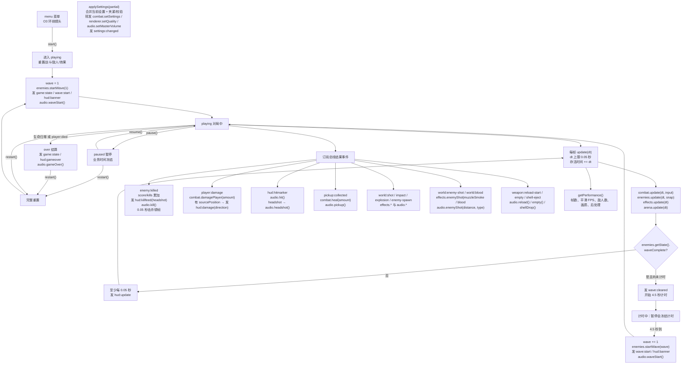

# 对局生命周期与计分

负责角色：游戏管线。当前状态：**v3 Model 与 Pipeline 设置/契约阶段已实现；32 项单元测试通过；服务 v3 setter 尚未实现；Electron 画面、设置面板与完整流程尚未验证。**

## 这个功能干什么

一局 DUSTLINE 需要有人统一管住“现在是什么状态”：主菜单、对局中、暂停、结算；还要决定什么时候开始下一波、击杀得多少分、玩家死亡后怎样显示成绩以及怎样重开。界面只负责把按钮点击转成开始/暂停/恢复/重开命令，并把 Pipeline 发出的事件显示出来；真正的状态推进、计分和波次协调由这个功能完成。

对玩家来说，成功后会发生这些事：

- 点“开始”进入第 1 波，屏幕收到波次横幅与 HUD 数据。
- 打死敌人会立刻加分、显示击杀信息并播放击杀音效；爆头会带专门的命中标记与音效，击杀信息也会标记爆头。
- 从背后/侧面受伤时，HUD 能收到相对玩家朝向的受击方向。
- 调整灵敏度、ADS 倍率、FOV、主音量或画质后，设置会立即保存、发给对应服务并广播 `settings:changed`。
- 按 ESC 暂停后，敌人、弹丸、波次计时和存活时间都停住；继续后接着打。
- 生命归零时只结算一次，显示得分、波次、击杀和存活时间。
- 点“重新开始”后分数、波次、击杀和存活时间全部归零，再从第 1 波开始；已应用的设置保留。

## 当前完整流程

触发入口是界面装配调用 `createGame()` 返回对象上的方法。所有状态变化都会通过共享事件总线发 `game:state`，HUD 通过 `hud:update` 刷新。



### 步骤说明

1. **菜单**：状态是 `menu`。`update(dt)` 只按 `GAME_CONFIG.match.menuCamera` 计算相机环绕位置，调用 `renderer.setCameraPose()`；战斗、敌人、效果都不推进。
2. **开始**：`start()` 只在 `menu` 生效。状态进入 `playing`，调用 `combat.reset()`、`enemies.reset()`、`effects.clear()`，得分 0、击杀 0、波次 1、存活时间 0，然后 `enemies.startWave(1)`。
3. **开始事件**：发 `game:state { state:'playing' }`、`wave:start { wave:1 }`、`hud:banner { title:'第 1 波', subtitle:'敌人来袭', durationMs:2200 }`，调用 `audio.waveStart()`，并立即发一次 `hud:update`。
4. **对局中每帧**：`update(dt)` 把 `dt` 限制到 0.05 秒；先记录性能帧，再累加存活时间，依次调用战斗、敌人、效果、竞技场。然后检查波次、死亡并按刷新间隔发 HUD。
5. **HUD**：载荷固定为 `{ score, wave, kills, health, maxHealth, ammo, magazineSize, reloading, reloadProgress, yaw, muted }`。开始、暂停、恢复、结算、重开、静音和下一波开始时立即刷新，其余时间至少每 0.05 秒一次。
6. **设置**：`applySettings(partial)` 把局部值合并到当前设置，夹紧/校验后保存；转发 `combat.setSettings({ mouseSensitivity, adsSensitivityMultiplier, fov })`、`renderer.setQuality(quality)`（或 `setPostProcessingEnabled`）与 `audio.setMasterVolume(masterVolume)`，再发 `settings:changed { settings }`。`getSettings()` 返回冻结副本；重开保留设置。服务缺少 setter 时每个方法只警告一次并跳过。
7. **性能仪表**：每次 `update(dt)` 累加 `frameCount` 并用原始帧时间平滑 FPS；`getPerformance()` 返回 `{ fps, frameCount, enemyCount, quality, postProcessing }`。敌人数量取 `enemies.getState().alive`，画质优先取渲染器 `getQuality()`。这是运行时读数，不是帧率验收。
8. **击杀与爆头**：收到 `enemy:killed` 时，只有 `playing` 才计分；累加 `score` 与 `kills`，发 `hud:killfeed { enemyType, score, headshot, critical }`，调用 `audio.kill()`，并设置 0.05 秒顿帧。`hud:hitmarker.headshot` 会额外调用可选 `audio.headshot()`。
9. **伤害与拾取**：`player:damage` 转发给 `combat.damagePlayer(amount)`；若带 `sourcePosition`，再按玩家 yaw 发 `hud:damage { amount, direction }`（0 正前、正值在右）。`pickup:collected` 调用 `combat.heal(amount)` 与 `audio.pickup()`。两者都只在 `playing` 生效。带方向的受伤流程只播放一次受伤音效。
10. **世界效果**：`world:shot` → `effects.tracer(from, to, color)` + `audio.shoot()`；`world:impact` → `effects.impact()`；`world:explosion` → `effects.explosion()` + `audio.explosion()`；`world:enemy-spawn` → `effects.spawn()`；`pickup:spawn` → `effects.spawn(position)`；`world:enemy-shot` → `effects.enemyShot`（缺失时 `muzzleSmoke`）+ `audio.enemyShot(distance, enemyType)`；`world:blood` → `effects.blood()`；`weapon:shell-eject` → `effects.shell()` + `audio.shellDrop()`。
11. **波次**：每帧读取 `enemies.getState().waveComplete`。第一次为 `true` 时发 `wave:cleared { wave }` 并开始 4.5 秒计时；计时结束波次 +1，`enemies.startWave(wave)`，再发 `wave:start`、`hud:banner`，播放波次音效并刷新 HUD。暂停时计时冻结，待开始的波次不会重复启动。
12. **暂停/恢复**：`pause()` 只从 `playing` 生效，`resume()` 只从 `paused` 生效。暂停期间 `update(dt)` 不调用战斗、敌人、效果、竞技场，也不增加存活时间，只继续按间隔刷新 HUD；渲染仍由装配层执行。击杀顿帧计时在暂停时冻结。
13. **死亡**：`combat.getSnapshot().alive === false` 或收到 `player:died` 时，如果仍在 `playing` 且尚未结算，则进入 `over`，发 `game:state` 和 `hud:gameover { score, wave, kills, survivedSeconds }`，调用 `audio.gameOver()`。每局只发一次结算。
14. **重开**：`restart()` 从 `paused`、`over` 或 `playing` 都执行与开始相同的完整重置，然后重新进入 `playing` 并发第 1 波事件。从 `playing` 重开时状态不变，但 `game:state` 会再发一次，界面可据此清空击杀信息。设置与顿帧：设置保留，顿帧清除。
15. **静音（O4/M 键）**：`toggleMute()` 翻转静音布尔值，调用 `audio.setMuted(muted)`，并立即发带 `muted` 的 `hud:update`。
16. **只读状态（O4）**：`getState()` 返回状态字符串；`getSnapshot()` 返回冻结对象 `{ state, player, weapon, score, wave, kills, survivedSeconds, enemies, muted, settings, performance }`，可 `JSON.stringify`，供 `window.__DUSTLINE_TEST__` 读取。`applySettings()` 是设置入口，不是对局状态写接口。
17. **武器视图可见性**：调用可选的 `combat.setViewVisible(visible)`。`menu` 与 `over` 隐藏第一人称武器，`playing` 与 `paused` 显示。`createGame()` 初始化时隐藏；开始/重开在 `combat.reset()`（会把武器恢复为可见）之后显式显示；暂停/恢复/死亡时同步切换。旧版战斗服务没有该方法时安全跳过，调用失败会记录错误。
18. **释放**：`dispose()` 退订本对局注册的 16 个总线处理并清空波次计时；不调用服务 `dispose()`，也不清空整条总线。

## 在哪里核对

- 公共入口：[`src/pipelines/public/game.js`](../../../../src/pipelines/public/game.js)
- 纯状态机与计分：[`src/pipelines/impl/game-state.js`](../../../../src/pipelines/impl/game-state.js)
- 服务编排与主循环：[`src/pipelines/impl/game-pipeline.js`](../../../../src/pipelines/impl/game-pipeline.js)
- 事件名：[`src/models/events.js`](../../../../src/models/events.js)
- 数值与波次公式：[`src/models/game-config.js`](../../../../src/models/game-config.js)
- 载荷构造函数：[`src/models/contracts.js`](../../../../src/models/contracts.js)
- 单元测试：[`test/游戏管线/game-state.test.js`](../../../../test/游戏管线/game-state.test.js)
- 完整接口与事件接线：[`api-spec.md`](../../api-spec.md)

### 验证命令与实际结果

在项目根目录运行（Node v24，Windows 11，2026-10-17）：

```sh
node --test test/游戏管线/game-state.test.js
```

实际结果：

```text
tests 32
pass 32
fail 0
cancelled 0
skipped 0
todo 0
```

覆盖：人类敌人与波次占比、设置默认/范围/夹紧/非法值、applySettings 转发与渲染器回退、缺失 setter 容错、settings:changed 与快照、爆头命中/击杀信息、受伤方向、重复受伤音效抑制、敌人枪声/血雾/抛壳映射、性能字段、击杀顿帧与暂停/重开，以及状态机合法/非法迁移、计分账本、必需服务校验、O3 菜单镜头、武器视图可见性、开始事件顺序、击杀计分与音效、伤害/拾取转发、弹道转发、暂停冻结与恢复、0.05 秒钳制、死亡单次结算、`player:died` 事件结算、重开复位、4.5 秒波次间隔、静音与 HUD、O4 快照、`dispose` 退订。

导入冒烟：

```sh
node --input-type=module -e "Promise.all([import('./src/models/events.js'),import('./src/models/game-config.js'),import('./src/models/contracts.js'),import('./src/pipelines/public/game.js')]).then(([e,c,k,g])=>{console.log('events',Object.keys(e.EVENTS).length,'contracts',Object.keys(k).length,'game',typeof g.createGame)}).catch(e=>{console.error(e);process.exit(1)})"
```

实际输出：`events 26 contracts 40 game function`。

### 还没有验证的部分

- 没有 Electron 真实窗口证据：菜单环绕镜头构图、HUD 实际刷新、设置面板、暂停画面、死亡结算界面、重开后的场景清理都还没看过。
- 没有与真实战斗、敌方、环境、效果、音频服务联调；当前测试使用契约兼容的假服务 + 真实共享事件总线。
- 服务 v3 setter 尚未实现：战斗 `setSettings`、渲染 `setQuality`、音频 `setMasterVolume`/`enemyShot`/`headshot`/`shellDrop`、效果 `enemyShot`/`blood`/`shell` 目前只会触发一次警告并被跳过。
- 真实战斗服务的 `damagePlayer()` 也会发一次不含方向的 `hud:damage`；Pipeline 已保证受伤音效只响一次，但界面可能收到两次事件。需要战斗角色或项目管理确认最终契约。
- 其他角色旧测试仍引用 `drone/brute/wraith`，在其所有者更新前会失败。
- 真实敌方服务在下一波开始后是否及时清除 `waveComplete`，需要集成测试确认。
- 实际 FPS、30 敌人高画质性能、连续开始/重开 5 次后的对象数量与内存稳定性未测量。

## 演变历史

| 日期 | 类型 | 状态 | 变化 | 详细文档 |
| --- | --- | --- | --- | --- |
| 2026-10-17 | 初始实施 | Model 已验证；Pipeline 已实现、单元测试通过 | 写入共享事件、数值与数据契约；随后实现 `createGame()`、状态机、主循环、计分、波次、HUD、暂停/死亡/重开、O3 菜单镜头与 O4 只读状态 | [初始实施变更](../change/2026-10-17_change_initial-implementation.md) |
| 2026-10-17 | 修改 | 已实现、单元测试通过 | 菜单与结算隐藏第一人称武器，对局/暂停显示；开始/重开在 reset 后重新显示 | [初始实施变更](../change/2026-10-17_change_initial-implementation.md) |
| 2026-10-17 | v3 修改 | Model + Pipeline 设置/契约阶段已实现、32 项单元测试通过；服务 setter 待实现 | 人类敌人配置；设置默认/范围与转发；applySettings/getSettings/getPerformance；爆头、受伤方向、敌人枪声/血雾/抛壳映射；0.05 秒击杀顿帧 | [初始实施变更（v3 节）](../change/2026-10-17_change_initial-implementation.md) |
