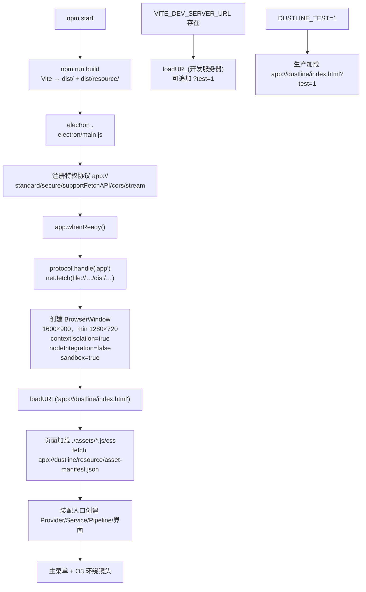
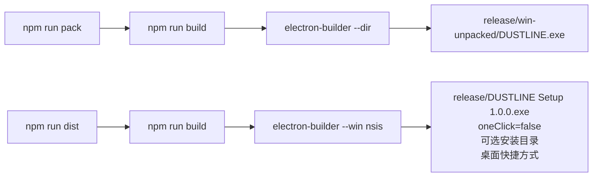

# 桌面启动与打包

负责角色：界面装配。当前状态：**v3 构建与 Electron 冒烟通过；初始版本的 pack/dist 曾实际生成并检查；本轮按任务要求未重新打包，安装/卸载仍未执行。**

## 这个功能干什么

玩家不打开浏览器，而是运行 Windows 桌面程序。Electron 主进程负责：

- 打开 1600×900、最小 1280×720 的窗口，标题为 `DUSTLINE · 尘埃战线`，隐藏菜单栏。
- 在生产模式通过特权 `app://` 协议提供 `dist/` 中的页面、脚本、样式和 `resource/` 素材。
- 禁止新窗口和外部导航，保持上下文隔离、关闭 Node 集成、启用沙箱。
- 不实现游戏逻辑；所有玩法都在渲染进程的五层结构中。

构建与打包负责：

- Vite 把 `index.html`、`src/main.js` 和依赖打包到 `dist/`，并把整个 `resource/` 复制到 `dist/resource/`。
- `npm run pack` 用 electron-builder 生成未压缩应用目录 `release/win-unpacked/`。
- `npm run dist` 生成 NSIS 安装包 `release/DUSTLINE Setup 1.0.0.exe`。

## 当前完整流程

### 启动



### 打包



### 步骤说明

1. **注册协议**：`protocol.registerSchemesAsPrivileged` 在 `app.whenReady()` 之前调用，使 `app://` 具备标准、安全、fetch、CORS 和流式能力。
2. **处理请求**：`protocol.handle('app')` 只接受 `dustline` 主机；路径限制在 `dist/` 内。包含 `..` 或解析后越界的请求返回 403；缺失文件记录后返回 404；正常文件交给 `net.fetch(pathToFileURL(...))`。
3. **创建窗口**：窗口初始隐藏，`ready-to-show` 后显示；关闭窗口即退出（Windows）。
4. **安全设置**：拒绝 `window.open`；`will-navigate` 只允许 `app://dustline/` 与已配置的 Vite 开发服务器；记录页面加载失败与渲染进程退出。
5. **开发模式**：如果设置 `VITE_DEV_SERVER_URL`，主进程直接加载该地址。Vite 开发服务器从项目根提供 `/resource/`，与构建后的 `./resource/` 语义一致。
6. **测试模式**：主进程在 `DUSTLINE_TEST=1` 时给加载 URL 追加 `?test=1`，渲染进程据此暴露只读的 `window.__DUSTLINE_TEST__`；默认不暴露。
7. **构建资源**：Vite `base: './'` 让构建后的资源用相对路径；`publicDir: false` 避免把 `resource/` 复制到 dist 根；构建插件在 `closeBundle` 用 `fs.cpSync(resource, dist/resource, { recursive: true })` 复制整个素材目录。
8. **打包**：electron-builder 配置 `appId: com.dustline.game`、`productName: DUSTLINE`、输出 `release/`、文件集合 `dist/**/*`、`electron/**/*`、`package.json`；Windows x64 NSIS，非一键安装，允许选择目录并创建桌面/开始菜单快捷方式。
9. **运行时资源**：`asar` 关闭，`electronDist` 指向已安装的 `node_modules/electron/dist`，避免 electron-builder 重新解压 Electron 后在部分 Windows 环境出现目录重命名失败。

## 窗口与安全参数

| 项目 | 值 |
| --- | --- |
| 窗口尺寸 | 1600 × 900；最小 1280 × 720 |
| 标题 | `DUSTLINE · 尘埃战线` |
| 背景色 | `#121512` |
| 菜单栏 | `autoHideMenuBar: true` |
| contextIsolation | `true` |
| nodeIntegration | `false` |
| sandbox | `true` |
| 新窗口 | 拒绝 |
| 外部导航 | 阻止并记录 |
| 关闭行为 | Windows 上关闭最后窗口即退出 |
| F11 | 渲染进程界面处理；主进程不重复接管 |

## 构建与打包配置

`package.json` 实际脚本：

```json
{
  "dev": "vite",
  "build": "vite build",
  "start": "npm run build && electron .",
  "pack": "npm run build && electron-builder --dir",
  "dist": "npm run build && electron-builder --win nsis",
  "test": "node --test test/界面装配/"
}
```

> 测试脚本说明：任务书给定的 `node --test test/界面装配/` 在 Node v24.11.1 会把目录参数当作模块解析。为保证该命令原样可运行，`test/界面装配/index.js` 作为目录入口导入真实测试文件 `hud-format.test.js`；没有使用临时 loader，也没有放宽断言。

## 在哪里核对

- Electron 主进程：[`electron/main.js`](../../../../electron/main.js)
- Vite 配置：[`vite.config.js`](../../../../vite.config.js)
- 打包配置：[`package.json`](../../../../package.json)
- 页面骨架：[`index.html`](../../../../index.html)
- 装配入口：[`src/main.js`](../../../../src/main.js)
- 冒烟脚本：[`scripts/smoke-electron.js`](../../../../scripts/smoke-electron.js)
- 接口说明：[`api-spec.md`](../../api-spec.md)

### 验证命令与实际结果

环境：Windows 11，Node v24.11.1，Electron 44.9.0，electron-builder 26.15.3，Vite 8.3.4，2026-10-17。

```sh
npm run build
```

实际结果：46 个模块转换成功，`dist/index.html` 8.66 kB、CSS 15.70 kB、JS 754.54 kB（gzip 199.22 kB）；`dist/` 约 19 MB，其中 `dist/resource/` 约 18 MB；素材复制成功。

```sh
node scripts/smoke-electron.js
```

实际结果：真实 Electron 窗口标题为 `DUSTLINE · 尘埃战线`，canvas 存在，装载层隐藏，开始按钮启用，O4 钩子存在；点击开始后状态 `playing`，HUD 生命 100、弹药 30、波次 1，全部 PASS。

v3 冒烟新增检查（同一脚本）：

```text
PASS: O4 getSettings() / getPerformance() 已暴露并返回完整对象
PASS: 菜单“设置”打开面板，主菜单保留在背景
PASS: 画质切到 low 后渲染器 getPerformance().quality === 'low'
PASS: 低画质 postProcessing === false
PASS: 设置写入 localStorage 键 dustline.settings.v3
PASS: 恢复默认把画质改回 high，关闭面板后 settingsVisible=false
```

v3 构建实际结果：68 modules；`dist/index.html` 11.83 kB、CSS 18.59 kB、JS 1005.33 kB（gzip 292.79 kB）；`resource/` 复制成功。

设置跨 Electron 重启（同一用户数据目录、`app://dustline` 源）：

```text
第一次启动：面板把 FOV 改为 83，localStorage {"fov":83,...}
关闭后第二次启动：getSettings().fov === 83，localStorage 仍为 83
第二次打开设置面板：滑杆值 83，显示 83°
点击恢复默认：FOV 回到 75
PASS: settings survived Electron relaunch
PASS: panel values reflect persisted settings on boot/open
```

本轮未运行 `npm run pack` 与 `npm run dist`（任务要求由 PM 在所有阶段完成后统一打包）；以下 pack/dist 结果是初始版本的历史证据，v3 最终包需 PM 重新生成并复测。

```sh
npm run pack
```

实际结果：退出码 0；生成 `release/win-unpacked/DUSTLINE.exe` 与 `release/win-unpacked/resources/app/`；未压缩目录约 400 MB。

```sh
npm run dist
```

实际结果：退出码 0；生成 `release/DUSTLINE Setup 1.0.0.exe`（约 126 MB）与 `release/DUSTLINE Setup 1.0.0.exe.blockmap`（约 135 KB）；NSIS 3.0.4.1、7zip 与 NSIS 资源下载成功。

打包后的应用实际启动检查：

```text
PASS: packaged title (DUSTLINE · 尘埃战线)
PASS: packaged app loads arena resources
PASS: packaged start -> playing HUD
PASS: packaged ESC pause
```

开发服务器检查：`npm run dev` 启动后，`http://localhost:5173/`、`/src/main.js`、`/resource/asset-manifest.json`、`/resource/hdri/kloofendal_48d_partly_cloudy_puresky_1k.hdr` 均返回 HTTP 200。

### 遇到的问题与处理

- **首次 `npm run pack` 失败**：electron-builder 解压 Electron 后在 `rename release/win-unpacked.tmp -> release/win-unpacked` 报 `EPERM: operation not permitted`。重试仍失败；目录内文件没有单独锁。处理方式：在 `package.json` 的 `build` 配置加入 `"electronDist": "node_modules/electron/dist"`，让 electron-builder 直接复制已安装的 Electron 运行时，跳过“解压到 tmp 再重命名”的步骤。之后 `pack` 与 `dist` 均稳定成功。
- **asar**：为了让 `app://` 处理器用 `net.fetch(file://...)` 读取打包后的 `dist/` 路径更直接，配置 `"asar": false`。electron-builder 会提示不建议关闭 asar，但当前包在该配置下实际启动成功。后续若要启用 asar，需要重新验证 `net.fetch` 对 asar 内文件的读取。
- **默认图标**：尚未提供应用图标，electron-builder 使用默认 Electron 图标；`build/` 图标资源与代码签名证书未配置。
- **应用标题**：窗口标题与 HTML 标题均为 `DUSTLINE · 尘埃战线`。

### 还没有验证的部分

- NSIS 安装包的实际安装、快捷方式创建、升级与卸载未执行。
- 代码签名证书未配置；日志里的 `signtool.exe` 不带正式证书。
- 未在另一台没有 Node/开发环境的 Windows 机器上运行安装包。
- 未验证 macOS/Linux；设计明确不包含这些目标。
- 正式视觉验收仍待项目管理/美术查看真实截图。
- v3 设置依赖 `app://dustline` 源下的 localStorage 持久化；跨重启已实测，但打包后的应用使用同一用户数据目录的行为需 PM 最终包复测。
- v3 的 `npm run pack` / `npm run dist` 本轮未执行；初始版本的安装包结果不能替代 v3 最终包。

## 演变历史

| 日期 | 类型 | 状态 | 变化 | 详细文档 |
| --- | --- | --- | --- | --- |
| 2026-10-17 | 初始实施 | 已实现，build/smoke/pack/dist 通过；安装/卸载未执行 | 建立 Electron 主进程、`app://` 协议、Vite 构建与素材复制、Windows NSIS 打包配置和启动冒烟 | [初始实施变更](../change/2026-10-17_change_initial-implementation.md) |
| 2026-10-17 | v3 升级 | 构建与冒烟通过；pack/dist 待 PM | 构建产物更新为 68 modules；冒烟加入设置/O4/低画质；设置跨重启持久化实测；环境引擎 v3 方法已落地并接入 `getDecals()` | [初始实施变更的 v3 章节](../change/2026-10-17_change_initial-implementation.md#v3-界面设置爆头方向受击与启动接线) |
