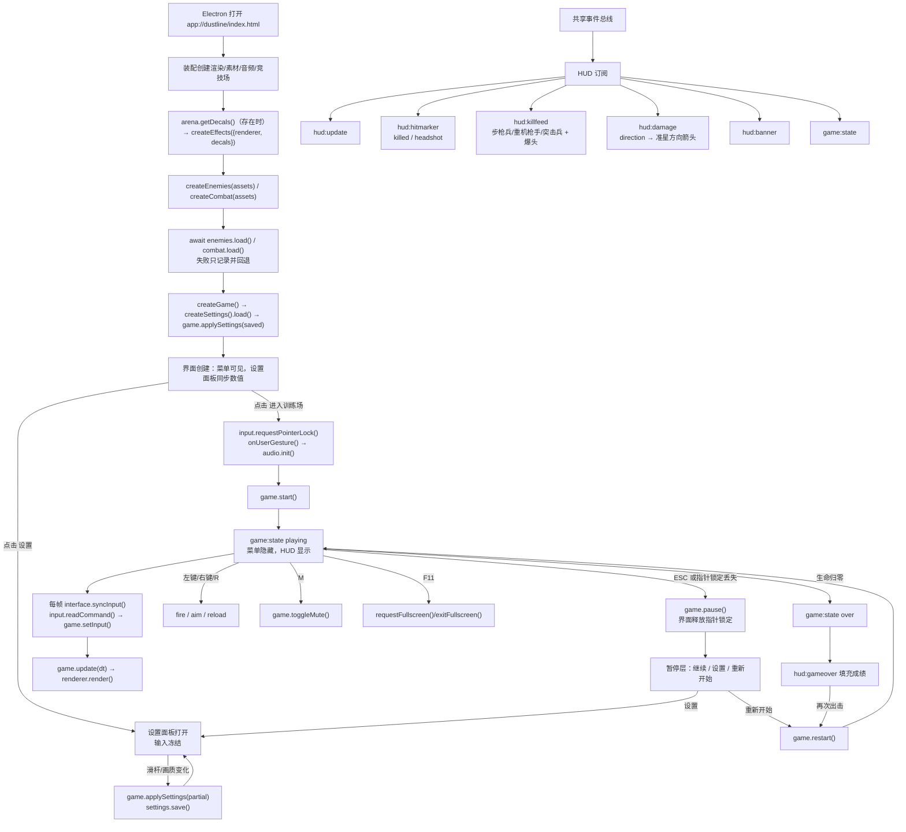

# 对局界面与输入

负责角色：界面装配。当前状态：**v3 已实现；层内测试、构建与真实 Electron 流程检查通过；正式 v3 视觉验收待项目管理/美术。**

## 这个功能干什么

玩家双击桌面程序后先看到 DUSTLINE 主菜单：标题、作战简报、操作表、设置按钮、开始按钮和 CC0 素材授权说明。点击“进入训练场”后鼠标被锁定，玩家用 WASD 移动、鼠标观察、左键射击、右键瞄准、R 换弹、Shift 冲刺、Space 跳跃、M 静音、F11 全屏。屏幕上有罗盘、击杀信息、得分/波次、生命条、弹药、准星、爆头/普通命中标记、方向受击箭头和波次横幅。按 ESC 或指针锁定丢失会暂停；菜单和暂停都能打开设置面板；死亡后显示得分、波次、击杀和存活时间，并可以立即重开。

界面只展示 Pipeline 发布的数据，并把按钮/键鼠操作转发给 Pipeline，把设置变化交给 `game.applySettings()`。它不计算伤害、分数、波次、爆头或命中结果，也不读取战斗、敌人或环境服务的内部状态。

## 当前完整流程



### 步骤说明

1. **创建界面**：装配入口在竞技场与人类模型加载完成后调用 `createInterface({ bus, game, canvas, testMode, settings, onUserGesture })`。界面创建输入、设置面板与 HUD，隐藏装载层并启用开始按钮。
2. **恢复设置**：`src/main.js` 先 `createSettings({ storage: window.localStorage }).load()`，再 `game.applySettings(saved)`；设置面板打开时从 `game.getSettings()` 同步滑杆与画质。
3. **开始**：点击“进入训练场”后，界面先请求指针锁定并调用 `onUserGesture`（`audio.init()`），然后 `game.start()`。
4. **对局中每帧**：`interface.syncInput()` 读取并消费本帧键鼠状态，写入 `game.setInput()`；装配随后调用 `game.update(dt)` 与 `renderer.render()`。
5. **HUD 数据**：HUD 只订阅 `game:state`、`hud:update`、`hud:hitmarker`、`hud:killfeed`、`hud:damage`、`hud:banner`、`hud:gameover`。
6. **设置**：菜单/暂停“设置”打开面板；滑杆与画质下拉变化实时应用并保存。低画质经 Pipeline → `renderer.setQuality('low')` 关闭后处理。面板打开时输入层返回空命令，ESC 关闭面板；从暂停打开时对局保持 `paused`。
7. **暂停/继续/重开**：ESC、指针锁定丢失或失焦触发 `game.pause()`；继续调用 `resume()`，重新开始/再次出击调用 `restart()`。
8. **结算**：Pipeline 发 `game:state over` 与 `hud:gameover`；界面显示成绩。
9. **释放**：界面 `dispose()` 退订总线、移除按钮/键盘/鼠标/缩放监听、释放设置面板、清理击杀信息/横幅/命中/方向箭头定时器。

## HUD 与视觉内容（v3）

| 区域 | 内容 | 数据来源 |
| --- | --- | --- |
| 顶部中央 | 罗盘条：北/东北/东/东南/南/西南/西/西北，15° 刻度，方位角数字 | `hud:update.yaw` |
| 左上 | 击杀信息：步枪兵/重机枪手/突击兵 + `+分数` + `爆头` 标签，最多 5 条，约 4 秒淡出 | `hud:killfeed` |
| 右上 | 得分、波次、击杀、静音标记 | `hud:update` |
| 底部中央 | 生命条与数值，≤30% 红色低血状态 | `hud:update.health/maxHealth` |
| 右下 | `30 / ∞` 弹药、`AR-15 · 制式步枪`、换弹进度与“换弹中” | `hud:update.ammo/reloading/reloadProgress` |
| 中央 | 准星（ADS 收拢、移动扩散）、ADS 提示、普通/击杀/爆头命中标记 | 输入状态 + `hud:hitmarker` |
| 准星周围 | 方向受击短箭头：0 正前、正值在右；红色受伤边缘与低血持续红边 | `hud:damage.direction` + 生命比例 |
| 波次横幅 | `第 N 波` / `敌人来袭`，2200 毫秒 | `hud:banner` |
| 设置 | 鼠标灵敏度、ADS 倍率、FOV、主音量、画质高/低、实时数值、恢复默认、关闭 | 本地设置 + `game.getSettings()` |
| 暂停 | 继续行动、设置、重新开始、操作提醒 | `game:state` |
| 结算 | 得分、波次、击杀、存活时间、再次出击 | `hud:gameover` |
| 主菜单 | DUSTLINE 标题、人类士兵简报、操作表、设置、进入训练场、CC0 授权 | 静态 HTML + 装载状态 |

### 爆头与方向受击

- `hud:hitmarker` 读取 `headshot`：爆头使用更大、偏红（`--danger-bright`）的命中标记与独立动画；击杀标记保留。
- `hud:killfeed` 读取 `headshot`（兼容 `critical`），显示“爆头”标签；敌人名称映射为步枪兵/重机枪手/突击兵。
- `hud:damage.direction` 为攻击来源相对玩家朝向的弧度：0 正前、正值在右、范围 -π..π。HUD 用 `damageDirectionDegrees()` 规范到 (-180, 180]，再旋转准星周围的箭头；缺失 `direction` 时只闪红色边缘。
- 红色只用于受伤、低血与危险提示；不使用霓虹或发光描边。

### 罗盘方位约定

- 战斗服务 `yaw = 0` 朝向 -Z；本项目把 -Z 定义为北 0°。
- 鼠标右移产生正 `movementX`，战斗服务执行 `yaw -= lookDeltaX × 灵敏度`，所以 yaw 减小、方位角增大。
- HUD 用 `heading = (-yaw × 180 / π)` 规范到 `[0, 360)`。

## 输入映射

| 按键/鼠标 | InputCommand 字段 | 行为 |
| --- | --- | --- |
| W / S / A / D | `moveForward` / `moveRight` | 前后左右移动 |
| Shift | `sprint` | 冲刺 |
| Space | `jump` | 本帧跳跃（按下沿） |
| 鼠标移动 | `lookDeltaX/lookDeltaY` | 视角；指针锁定后累积，每帧消费后清零 |
| 左键 | `fire` | 按住自动射击 |
| 右键 | `aim` | 按住瞄准（O1） |
| R | `reload` | 本帧换弹（按下沿） |
| M | 无 | `game.toggleMute()` |
| F11 | 无 | 切换浏览器全屏 |
| ESC | 无 | 退出指针锁定 / 显式暂停；设置面板打开时关闭面板 |

设置面板打开时，移动/射击/换弹/视角输入被冻结，`readCommand()` 返回空命令；键盘方向键仍可用于操作滑杆和下拉。指针锁定丢失会清空全部按键状态；锁定后的前两次 `mousemove` 被忽略，避免光标居中造成视角跳变。

## 设置面板与本地保存

- 存储键：`dustline.settings.v3`（localStorage）。
- 首次启动：Model 默认值（灵敏度 1.0、ADS 0.8、FOV 75、音量 0.7、画质 high）。
- 有效存储：启动时读取并 `game.applySettings(saved)`；重开对局保留设置。
- 损坏 JSON / 非法字段：记录 `console.error`，回退默认值，不把坏值写进运行时。
- 保存：任一控件变化或恢复默认时写入完整归一化对象。
- 跨 Electron 重启：已实测 FOV 83 在第二次启动后保留，随后恢复默认。

## 失败与边界处理

- **缺少 DOM 元素**：`createHud()` / `createSettingsPanel()` 抛出带元素 id 的 `Error`，装配启动失败并显示错误。
- **指针锁定被拒绝**：记录错误，游戏仍可开始；可再次点击画布请求锁定。
- **音频初始化失败**：Promise 拒绝被捕获并记录；游戏流程不中断。
- **全屏失败**：记录错误，不改变游戏状态。
- **事件载荷非法**：HUD 记录后忽略。
- **设置存储异常**：读取/写入失败记录错误并回退/保留内存状态。
- **服务预加载失败**：`enemies.load()` / `combat.load()` 失败记录后继续，服务使用程序化回退。
- **竞技场缺少 `getDecals()`**：记录警告，效果服务不接弹孔贴片。

## 在哪里核对

- 页面骨架：[`index.html`](../../../../index.html)
- 样式：[`src/style.css`](../../../../src/style.css)
- 界面公共入口：[`src/interface/public/index.js`](../../../../src/interface/public/index.js)
- HUD：[`src/interface/impl/hud.js`](../../../../src/interface/impl/hud.js)
- 设置：[`src/interface/impl/settings.js`](../../../../src/interface/impl/settings.js)
- 输入：[`src/interface/impl/input.js`](../../../../src/interface/impl/input.js)
- 装配接线：[`src/main.js`](../../../../src/main.js)
- 单元测试：[`test/界面装配/hud-format.test.js`](../../../../test/界面装配/hud-format.test.js)、[`settings.test.js`](../../../../test/界面装配/settings.test.js)

### 验证命令与实际结果

```sh
node --test test/界面装配/settings.test.js test/界面装配/hud-format.test.js
# tests 27 / pass 27 / fail 0

npm test
# tests 27 / pass 27 / fail 0

npm run build
# 成功；68 modules；dist/index.html 11.83 kB、CSS 18.59 kB、JS 1005.33 kB（gzip 292.79 kB）
```

`node scripts/smoke-electron.js` 实际结果：标题、canvas、装载、开始按钮、O4、getSettings/getPerformance、设置面板打开/关闭、低画质转发与后处理关闭、localStorage 写入、恢复默认、开始后 `playing`/HUD/快照全部 PASS。

设置跨重启：第一次启动设置 FOV=83 并写入 localStorage；关闭后第二次启动 `getSettings().fov === 83`；打开面板时滑杆值 `83`、显示 `83°`；恢复默认回到 75。

暂停设置：开始 → ESC → `paused`；点击暂停层“设置” → `settingsVisible=true`、state 仍为 `paused`；ESC 关闭 → 暂停层仍在、state 仍为 `paused`。

### 还没有验证的部分

- **正式 v3 视觉验收尚未执行。** 菜单/HUD/设置面板只做了布局与可见性检查。
- 真实战斗中的爆头标记、`爆头` 击杀信息与方向受击箭头观感未人工验收。
- **环境引擎 v3 方法已落地**：竞技场 `getDecals()`、效果服务 `blood/bulletHole/muzzleSmoke/shell/enemyShot`、音频服务 `setMasterVolume/headshot/shellDrop/enemyShot`、渲染器 `setQuality/getQuality`。main 已把贴片系统传给效果服务；构建与冒烟通过，但实际弹孔/血雾/枪口烟/抛壳画面与音量听感仍需独立测试与视觉验收。
- `npm run pack` / `npm run dist` 本轮未执行（PM 统一最终打包）。
- 真人完整游玩、音频听感、30 敌人性能、长时间内存、安装/卸载未验证。

## 演变历史

| 日期 | 类型 | 状态 | 变化 | 详细文档 |
| --- | --- | --- | --- | --- |
| 2026-10-17 | 初始实施 | 已实现，层内与真实窗口检查通过；视觉验收待定 | DUSTLINE 菜单/HUD/暂停/结算、键鼠、指针锁定、F11、O1、O3、O4 | [初始实施变更](../change/2026-10-17_change_initial-implementation.md) |
| 2026-10-17 | v3 升级 | 已实现；27 项测试、构建、冒烟、设置持久化通过；视觉验收待定 | 设置持久化/面板、爆头/方向受击、人类敌人名称、assets/load/decals、O4 设置与性能 | [初始实施变更的 v3 章节](../change/2026-10-17_change_initial-implementation.md#v3-界面设置爆头方向受击与启动接线) |
