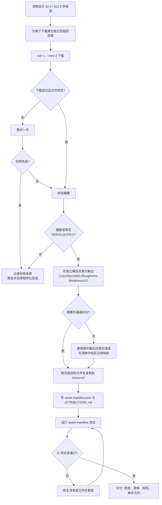
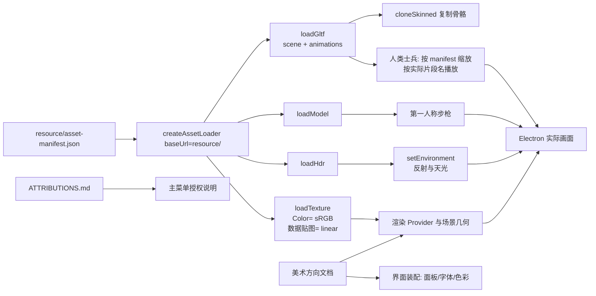

# 写实军事 CC0 素材与视觉规范

## 这个功能解决什么问题

游戏需要一个阴天军事训练场，而不是纯色几何体。这个功能负责把设计文档 §2.4 指定的 CC0 天空、贴图和步枪模型取回来，校验它们是真实可用的文件，登记来源与授权，并把“哪张贴图贴在哪里、整体什么颜色光线、界面怎么配色”写成实现者能直接照做的规范。

玩家最终看到的是：灰白阴天、尘土碎石地面、混凝土掩体、波纹钢集装箱、木箱和沙袋，以及一把哑光金属步枪。所有素材都可以免费用于本项目，来源可追溯。

v3 追加人类士兵：四个 Quaternius 低多边形动画 GLB 提供步枪兵、重机枪手和突击兵的基础身体与动作；头盔、面罩、背心、弹匣袋、护膝、手套和步枪由敌方服务用程序化几何叠加。美术负责确认这些 GLB 的真实动画名、尺寸、朝向、根运动与授权，并把结果写进清单，避免敌方服务靠猜。

## 当前行为

### 已经做到的

- 设计 §2.4 的 8 个 v2 来源全部下载成功，没有失败项，也没有启用程序化回退。
- `resource/` 中保留了 29 个素材文件：1 个 HDRI、5 个 GLB（步枪 + 4 个人类模型）、23 张 JPG 贴图，共约 22.7 MB；另有清单与授权两个文档。
- 每个文件都通过魔数校验：JPEG 以 `FF D8 FF` 开头并以 `FF D9` 结尾，HDR 以 `#?RADIANCE` 开头，GLB 以 `glTF` 开头。
- `resource/asset-manifest.json` 按调度记录 §4 的冻结结构记录材质分组、HDRI、模型和逐文件资产条目。
- `resource/ATTRIBUTIONS.md` 逐文件记录作者、来源、CC0 授权和下载日期。
- `test/美术/asset-manifest.test.js` 的 11 项自动检查全部通过（v2 时 8 项，v3 扩展后 11 项）。
- `docs/design/2026-10-17_design_art-direction.md` 写明色彩、光照、材质到表面的映射和消费方式。
- 2026-10-17 用管理角色捕获的 `test/项目管理/screenshots/menu-04.png` 与 `gameplay-03.png` 完成首轮视觉验收：阴天/部分多云天空、灰蓝雾、低饱和军用色、柔和阴影成立，地面/混凝土/木材/波纹钢表面可辨认，没有霓虹元素；结论为通过。
- 步枪 GLB 已评估：第一人称轮廓可辨，但画面中偏暗，机匣与护木的材质区分不明显；列为非阻塞打磨项，不触发程序化替换。
- 沙袋颜色通道替换已评估：本轮可接受（法线/粗糙度/AO 保留，堆叠在游戏距离读作卡其），但要求后续改用“真实颜色贴图的保亮度卡其重映射”，不长期保留纯程序化噪声颜色。

### v3 人类模型（2026-10-17）

- 四个 Quaternius CC0 GLB 已下载到独立空临时目录，校验后复制到 `resource/models/`，未修改内容。全部 HTTP 200、`glTF` 魔数正确、JSON chunk 可解析、声明的总长度等于文件大小。
- 清单新增 `models.humans`：`rifleman`（adventurer / woman-casual / woman-formal）、`heavy`（adventurer）、`breacher`（man-base）。每个条目记录完整实际动画名、建议缩放、朝向和根运动。
- 实测结果：

| 模型 | 大小 | 三角面 | 骨架 | 身高 | 1.8 m 缩放 | 朝向 | 根运动 |
| --- | --- | --- | --- | --- | --- | --- | --- |
| Adventurer | 1,944,116 B | 10,198 | 62 关节 / 5 蒙皮 | 1.827 m | 0.985 | +Z | 无 |
| Woman Casual | 1,530,616 B | 6,424 | 62 关节 / 4 蒙皮 | 1.810 m | 0.995 | +Z | 无 |
| Woman Formal | 1,491,780 B | 6,108 | 62 关节 / 4 蒙皮 | 1.800 m | 1.000 | +Z | 无 |
| Man base | 493,196 B | 1,852 | 31 关节 / 1 蒙皮 | 4.827 m | 0.373 | +Z | 无 |

- 动画名：Adventurer/Woman 前缀 `CharacterArmature|`，24 段；Man 前缀 `HumanArmature|`，11 段。设计期望的 `Idle_Gun`、`Walk`、`Run`、`Run_Shoot`、`Gun_Shoot`、`HitRecieve`、`Death` 在 Adventurer/Woman 上全部存在；Man 有 `Man_Idle`、`Man_Standing`、`Man_Walk`、`Man_Run`、`Man_Punch`、`Man_Death`，但没有 `Punch_Left/Right`、`Idle_Gun`、`Gun_Shoot`、`Run_Shoot`、`HitRecieve`。
- `ATTRIBUTIONS.md` 已记录四个模型的下载 URL、来源页、作者、CC0 授权、下载日期与动画验证结论。
- `test/美术/asset-manifest.test.js` 扩展为 11 项检查，`node --test test/美术/asset-manifest.test.js` 实际结果 11 pass / 0 fail。
- 四个模型没有内嵌纹理，材质是低多边形纯色；装具必须程序化叠加。完整视觉方向见美术方向文档第 8–11 节。

### v3 视觉复核（2026-10-17）

已检查：`test/项目管理/screenshots-v3/menu-02.png`、`gameplay-08.png`；`test/敌方服务/evidence/spawn-1.png`…`spawn-4.png`；`test/战斗服务/evidence/2026-10-17_view-model-hip-final.png`、`..._ads-final.png`。

通过的部分：

- 人类士兵方向成立：spawn 四角度均为人形士兵，人体尺度正常，巨型面罩/面板已消失；头盔、面罩、背心与步枪可辨。
- 场景与氛围成立：HESCO/沙袋墙、混凝土、集装箱、帐篷、警戒塔、探照灯、围栏与地面杂物可见；低角度阳光、长阴影、雾与后处理（SSAO/Bloom/分级/暗角/颗粒）可见；整体低饱和，无无人机与霓虹。
- 菜单保持写实军事简报风，设置入口与授权说明可读；HIP/ADS 武器占屏与位置在目标范围内。

当时发现的阻塞项（已在后续材质复核中解决）：

1. 第一人称步枪：护木与弹匣明显偏蓝，枪托偏酒红；与美术方向 §9.2 的深灰金属/`#232623` 哑光聚合物分层不符，画面读作玩具塑料而不是军用武器。需战斗服务完成材质复核后重新截图。

非阻塞打磨：

1. 敌军制服绿色略饱和，部分单位出现红色贝雷帽；建议向橄榄/卡其靠拢，红色只保留小面积识别或改为暗色。
2. HESCO/沙袋墙在游戏距离偏平滑，织纹不明显；近距离应能看到 Fabric084 织纹与模块缝隙阴影。
3. 太阳 Bloom 略强，可略微降低强度/阈值，保持阴天晨昏感。

静态截图无法验证：步/跑/射击/受击/死亡动画过渡、脚底贴地与滑步、装具逐帧穿模、ADS/HIP 过渡、30 敌人 + 高画质帧率、低画质回退。

### v3 材质复核（2026-10-17）

已检查更新后的 `gameplay-09.png`、`2026-10-17_view-model-hip-final.png` 与 `..._ads-final.png`。

- 武器阻塞项已解决：护木、弹匣、枪托使用深色聚合物（约 `#262420`），不再出现蓝色或酒红；机匣/枪管为深枪金属灰；木色只保留在小型握把贴片。HIP 位于画面右下约 26.6% 宽度，ADS 光学镜居中，未见近裁剪面穿插。
- **v3 静态视觉验收通过**：人类士兵、军事道具、低角度光照、后处理、低饱和与无霓虹均成立；武器不再读作玩具塑料。
- 先前三项非阻塞项维持非阻塞：敌军制服绿色略饱和/红色贝雷帽、HESCO 远距织纹、太阳 Bloom 略强。
- 仍需录屏或实际游玩确认：动画过渡、脚底贴地/滑步、装具逐帧穿模、ADS/HIP 过渡、30 敌人性能、低画质回退。

### 还没做到的

- 静态视觉验收已通过（2026-10-17 武器材质复核后）。以下动态项仍未验证：动画过渡、脚底贴地/滑步、装具逐帧穿模、ADS/HIP 过渡、30 敌人性能、低画质回退。
- v2 三项遗留已完成：Fabric084 真实贴图卡其重映射、木箱降红、步枪金属/聚合物分层（本轮复核通过）。
- Man 突击兵缺失 `Punch_Left/Right`、持枪和受击动画；敌方服务只能用单个 `Man_Punch`，并用受击闪白/音效补反馈。
- 步枪/重机枪手使用 Adventurer/Woman 的 `CharacterArmature|...` 片段；消费方必须匹配完整名或后缀，不能只查 `Run`。
- Heavy 的最终身高取决于“基础缩放 × 1.12”；当前清单记录基础缩放 0.985，放大由敌方服务按设计叠加。

## 素材入库流程

下图是实际执行的路径，包括失败分支。

本次实际结果：C 全部成功；I 全部通过；K 全部为“是”（所有需要的通道在源压缩包中都存在）；P 通过 11/11。G、L、Q 分支没有被触发。

v3 的四个 GLB 不经过解压：每个先下载到独立空目录，校验 HTTP 200、`glTF` 魔数、声明长度与文件大小一致、JSON chunk 可解析、目录中只有目标文件，再复制到 `resource/models/`。随后用 Node 内置模块读取 accessor、skin/IBM 和动画轨道，得到身高、朝向、根运动与实际片段名，写入清单与授权。

## 消费流程

环境引擎和界面装配不直接读 `resource/` 文件内容；它们通过清单与 Provider 使用素材。

人类模型消费约定：

- 从 `manifest.models.humans.<rifleman|heavy|breacher>` 取条目，用 `entry.url` 加载；不要硬编码模型路径。
- 按 `entry.scale` 缩放（Adventurer 0.985、Woman Casual 0.995、Woman Formal 1.000、Man 0.373）。Man 不缩放会变成约 4.8 米高。
- `forwardAxis` 为 `"+Z"`，模型正面朝 +Z；直接用移动方向设定 yaw，不要额外旋转 180°。
- 动画按 `entry.animations` 中的完整名匹配。设计期望名是后缀：例如 `Idle_Gun` → `CharacterArmature|Idle_Gun`，`Walk` → `HumanArmature|Man_Walk`。不要用 `find(name === 'Run')`。
- `rootMotion: false`：不要从动画提取位移；位置由 AI 控制。跑动/行走若滑步，按实际速度调整 `mixer.timeScale`。
- 复制多个士兵实例必须使用 Provider 导出的 `cloneSkinned`（SkeletonUtils），不能直接 `Object3D.clone()`。
- 重机枪手：基础缩放后再乘 1.12（约 1.103），或按设计只加装具体量。

加载失败时，Provider 必须记录具体 URL 与错误，并用美术方向文档第 2 节的颜色锚点程序化回退；不允许静默变成白色或黑色。

## 文件与接口

- 清单结构、字段含义和消费代码示例：`角色卡/美术/api-spec.md`
- 自动校验：`test/美术/asset-manifest.test.js`
- 运行命令：`node --test test/美术/asset-manifest.test.js`（根 `package.json` 已是 ESM，不再需要临时 loader）
- 当前结果：11 pass / 0 fail（2026-10-17，Node v24，Windows 11）；v2 与 v3 静态视觉验收均通过；动态动画/性能尚未验证
- 人类模型文件：`resource/models/quaternius-{adventurer,woman-casual,woman-formal,man-base}.glb`

## 历史

| 日期 | 类型 | 状态 | 变化 | 详细文档 |
| --- | --- | --- | --- | --- |
| 2026-10-17 | 设计 | designed | 确定写实军事色彩、光照与材质映射 | [美术方向](../design/2026-10-17_design_art-direction.md) |
| 2026-10-17 | 新增 | implemented-unverified | 下载 8 个 CC0 来源、入库 25 个文件、写清单与授权并通过 8 项测试；视觉验收待环境实现后进行 | [素材入库变更](../change/2026-10-17_change_asset-intake.md) |
| 2026-10-17 | 验证 | verified | 首轮视觉验收通过（menu-04 / gameplay-03）；记录帆布颜色替代、步枪偏暗、木箱偏红 3 项非阻塞打磨 | 截图 `test/项目管理/screenshots/menu-04.png`、`gameplay-03.png` |
| 2026-10-17 | v3 新增 | implemented-unverified | 4 个 Quaternius 人类 GLB、动画/尺寸/朝向/根运动验证、manifest/授权/11 项测试；尚未做 Electron 视觉检查 | 本文「v3 人类模型」节；[美术方向第 8–11 节](../design/2026-10-17_design_art-direction.md) |
| 2026-10-17 | v3 验证 | implemented-unverified | v3 视觉复核：人类士兵/场景道具/低角度光照/后处理/低饱和/无霓虹通过；步枪护木与弹匣偏蓝、枪托偏酒红为唯一阻塞项，验收暂缓 | 截图 `test/项目管理/screenshots-v3/`、`test/敌方服务/evidence/`、`test/战斗服务/evidence/` |
| 2026-10-17 | v3 复核 | verified | 武器材质复核通过（护木/弹匣/枪托为深色聚合物，无蓝/酒红）；v3 静态视觉验收通过；动态动画/性能仍未验证 | `gameplay-09.png`、`2026-10-17_view-model-hip-final.png`、`..._ads-final.png` |
